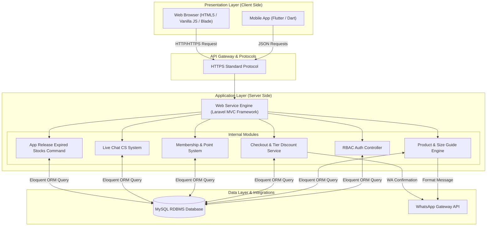
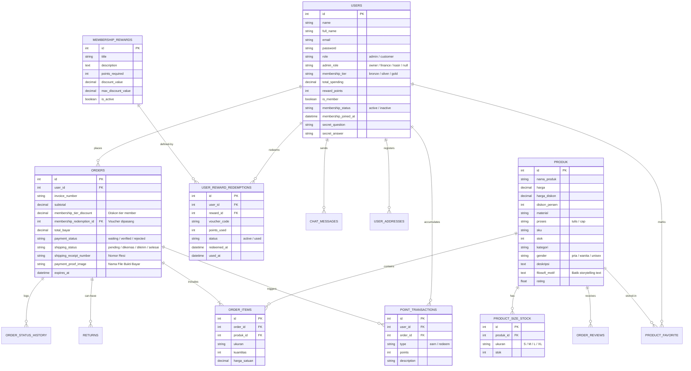
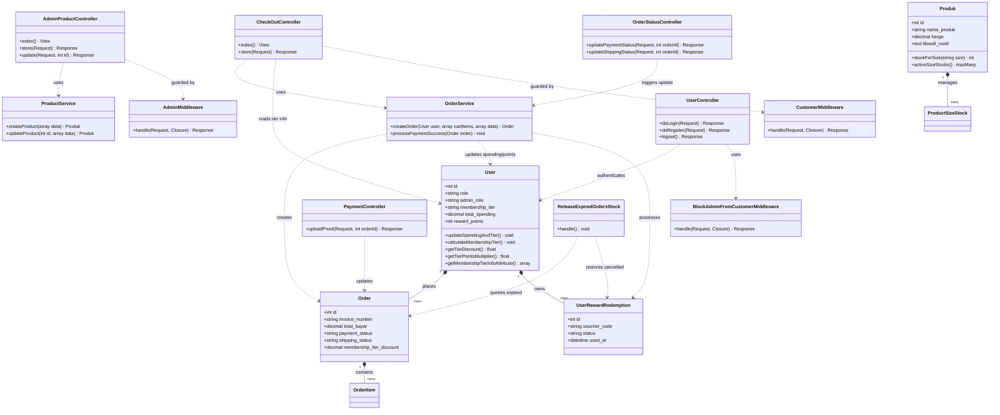

# DRAFT LAPORAN PROYEK SISTEM INFORMASI: BAB III
## PEMODELAN DAN PERANCANGAN SISTEM MOTIFNESIA

---

> [!NOTE]
> Dokumen ini adalah draf lengkap **BAB III (Pemodelan dan Perancangan)** yang disesuaikan secara khusus dengan kondisi riil aplikasi **Motifnesia** saat ini, termasuk seluruh fitur premium yang baru saja diimplementasikan (RBAC Admin, Smart Size Guide, WhatsApp Buy, Batik Storytelling, dan Tiered Membership). Draf ini dirancang menggunakan bahasa akademis formal bahasa Indonesia yang sesuai untuk standar laporan kuliah/tugas akhir.

---

## 3.1 Arsitektur Sistem

Arsitektur sistem MotifNesia dirancang dengan pendekatan **Multi-Tier Architecture** berbasis layanan terpisah untuk memisahkan antara lapisan presentasi (Presentation Layer), lapisan logika bisnis (Application Layer/Business Logic Layer), dan lapisan data (Data Layer). Pendekatan ini memastikan skalabilitas aplikasi, kemudahan pemeliharaan kode (maintainability), dan pemisahan tugas (separation of concerns) yang jelas.



### 3.1.1 Komponen Utama dalam Arsitektur

1. **Aplikasi Pengguna (Presentation Layer - Front-End)**
   * **Website (Blade & Vanilla JS):** Merupakan antarmuka web yang diakses melalui browser oleh pengunjung umum, pelanggan, dan pengelola. Halaman depan customer dinamis menggunakan AJAX/Fetch API untuk fitur interaktif seperti Live Search, Smart Size Guide, dan Checkout. Sisi admin web berfungsi sebagai panel manajemen terpadu (dashboard).
   * **Mobile App (Flutter - Dart):** Aplikasi berbasis mobile (Android/iOS) yang berinteraksi dengan server backend secara eksklusif menggunakan pertukaran data terstruktur (JSON).
2. **API Gateway / Jaringan Protokol**
   * Seluruh komunikasi data antara frontend (Mobile/Web) dan backend server difilter melalui lapisan HTTPS yang aman. Protokol RESTful API digunakan untuk melayani pertukaran data JSON pada perangkat mobile, sementara route web biasa menangani pemuatan halaman admin dan customer.
3. **Web Server (Application Layer - Back-End)**
   * Pusat pengolahan seluruh logika bisnis Motifnesia yang dibangun menggunakan framework **Laravel 11**. Backend menangani pemrosesan transaksi, manajemen keranjang, verifikasi role admin, alokasi poin reward membership, filter produk, serta perintah otomatis (cron job) untuk membatalkan pesanan yang kedaluwarsa.
4. **Database & API Pihak Ketiga (Data Layer)**
   * **MySQL Database:** Digunakan untuk menyimpan data persisten secara terstruktur (tabel users, produk, orders, dll). Akses ke database dienkapsulasi menggunakan Eloquent ORM untuk menjamin integritas referensial.
   * **WhatsApp Gateway API:** Digunakan oleh fitur "Pesan via WhatsApp" untuk mengarahkan pengguna ke ruang chat WhatsApp admin dengan pesan dinamis yang sudah terformat otomatis dari sistem.

---

## 3.2 Pemodelan Sistem dan Data

### 3.2.1 Hierarki Pengguna & Role-Based Access Control (RBAC)

Dalam sistem Motifnesia, hak akses pengguna diatur secara ketat menggunakan sistem **Role-Based Access Control (RBAC)**. Pengguna dibagi menjadi dua role utama di tingkat database: `customer` dan `admin`. Khusus untuk role `admin`, sistem membaginya kembali menjadi tiga sub-role operasional menggunakan kolom `admin_role` pada database untuk mencegah terjadinya penyalahgunaan hak akses (*privilege abuse*):

1. **Owner (`owner`):** Memiliki hak akses penuh (100% fitur) terhadap seluruh modul admin tanpa pengecualian, termasuk melihat grafik performa bisnis, mengakses laporan laba rugi, mengedit/hapus produk, mengelola promo, memoderasi ulasan, dan mengelola akun pelanggan.
2. **Finance (`finance`):** Sub-role yang berfokus pada verifikasi bukti transaksi keuangan dan pelaporan omzet. Finance hanya dapat mengakses halaman **Status Pengiriman** (untuk menyetujui/menolak bukti transfer pembayaran dari customer) dan **Laporan Penjualan**. Finance dilarang mengakses manajemen data produk, mengedit konten statis, atau memproses pengiriman fisik barang.
3. **Kasir / Customer Service (`kasir`):** Sub-role yang berfokus pada operasional gudang dan interaksi dengan customer. Kasir hanya memiliki akses **Read-Only** pada manajemen produk (untuk melihat stok baju), meng-update status ekspedisi pengiriman (seperti memasukkan nomor resi ekspedisi dan mengubah status menjadi "Dikirim"), serta menangani live chat bantuan dan proses retur barang. Kasir dilarang memverifikasi pembayaran keuangan atau mengubah data master produk.

Tabel berikut menggambarkan pemetaan fungsionalitas utama sistem (Use Case) terhadap aktor yang terlibat:

| No. | Use Case | Guest | Customer | Admin (Owner) | Admin (Finance) | Admin (Kasir) |
| :--- | :--- | :---: | :---: | :---: | :---: | :---: |
| 1 | Registrasi & Login | Akun Baru | Login / Out | Login / Out | Login / Out | Login / Out |
| 2 | Cari & Filter Live Search | Halaman Depan | Halaman Depan | - | - | - |
| 3 | Read Batik Storytelling | Detail Produk | Detail Produk | - | - | - |
| 4 | Smart Size Guide | Detail Produk | Detail Produk | - | - | - |
| 5 | Quick Buy via WhatsApp | Detail Produk | Detail Produk | - | - | - |
| 6 | Kelola Keranjang Belanja | - | Tambah/Ubah/Hapus | - | - | - |
| 7 | Checkout dengan Tier Discount | - | Validasi & Pilih | - | - | - |
| 8 | Upload Bukti Bayar | - | Kirim Gambar | - | - | - |
| 9 | Lacak Pesanan (Tracking) | - | Baca Status | - | - | Ya (Update Resi) |
| 10 | Berikan Ulasan & Rating | - | Kirim Review | - | - | - |
| 11 | Kelola Wishlist & Bandingkan | - | Simpan/Banding | - | - | - |
| 12 | Live Chat Support | - | Kirim Pesan | Balas Chat | - | Balas Chat |
| 13 | Dashboard Membership | - | Progress Bar/Koin | - | - | - |
| 14 | Manajemen Produk (CRUD) | - | - | Full CRUD | - | Read-Only |
| 15 | Verifikasi Pembayaran | - | - | Ya | Ya | - |
| 16 | Kelola Retur & Komplain | - | Ajukan | Ya | - | Ya |
| 17 | Kelola Promo & Kupon | - | Gunakan | Ya | - | - |
| 18 | Laporan Penjualan (Omzet) | - | - | Ya | Ya | - |
| 19 | Kelola Konten Statis | - | - | Ya | - | - |

---

### 3.2.2 Diagram Use Case

```mermaid
usecaseDiagram
    actor Guest as "Guest / Pengunjung"
    actor Customer as "Customer / Pelanggan"
    actor AdminOwner as "Admin (Owner)"
    actor AdminFinance as "Admin (Finance)"
    actor AdminKasir as "Admin (Kasir)"

    %% Guest Use Cases
    rect rgb(240, 240, 240)
        Guest --> (Registrasi Akun)
        Guest --> (Live Search & Filter)
        Guest --> (Baca Storytelling & Filosofi)
        Guest --> (Gunakan Smart Size Guide)
        Guest --> (Quick Buy via WhatsApp)
    end

    %% Customer Use Cases
    rect rgb(220, 240, 220)
        Customer --> (Login / Forgot Password)
        Customer --> (Kelola Keranjang Belanja)
        Customer --> (Checkout & Tier Discount)
        Customer --> (Unggah Bukti Bayar)
        Customer --> (Lacak Status Pengiriman)
        Customer --> (Tukar Poin & Gunakan Voucher)
        Customer --> (Kirim Live Chat & Review)
    end

    %% Admin Shared/Specific Use Cases
    rect rgb(220, 220, 240)
        AdminOwner --> (Manajemen CRUD Produk)
        AdminOwner --> (Verifikasi Bukti Transfer)
        AdminOwner --> (Laporan Keuangan & Grafik Omzet)
        AdminOwner --> (Broadcast & Kelola Promo)
        AdminOwner --> (Kelola Konten Statis Homepage)

        AdminFinance --> (Verifikasi Bukti Transfer)
        AdminFinance --> (Laporan Keuangan & Grafik Omzet)

        AdminKasir --> (Manajemen CRUD Produk - Read Only)
        AdminKasir --> (Input Resi & Kirim Barang)
        AdminKasir --> (Balas Live Chat & Kelola Retur)
    end
```

#### Deskripsi Fitur Utama (Premium Features) dalam Use Case:

1. **Smart Size Guide (Kalkulator Ukuran)**
   * **Deskripsi:** Fitur ini diintegrasikan ke halaman detail produk. Calon pembeli (Guest & Customer) dapat mengklik "Cari Ukuran Anda", lalu memasukkan tinggi badan (cm) dan berat badan (kg). Sistem akan menghitung Indeks Massa Tubuh (BMI) pengguna dan memetakan hasilnya dengan rentang ukuran produk yang tersedia (S, M, L, XL) secara matematis untuk memberikan rekomendasi ukuran terbaik.
2. **WhatsApp Quick Buy Button**
   * **Deskripsi:** Tombol cepat yang memfasilitasi pengguna yang lebih menyukai transaksi non-aplikasi. Ketika diklik, sistem secara otomatis mengemas data produk (nama, ukuran terpilih, harga diskon, link produk) menjadi pesan teks terformat rapi dan mengarahkan WhatsApp pengguna langsung ke nomor admin.
3. **Batik Storytelling Tab (Filosofi Motif)**
   * **Deskripsi:** Tab edukatif di detail produk yang menyajikan narasi budaya di balik motif batik tersebut. Bertujuan untuk meningkatkan nilai seni (artistic value) kain batik dan meyakinkan pelanggan untuk membeli produk.
4. **Tiered Membership (Bronze, Silver, Gold)**
   * **Deskripsi:** Program loyalitas pelanggan otomatis. Ketika customer melakukan transaksi sukses (`payment_status = 'verified'`), total belanjanya akan diakumulasikan ke kolom `total_spending`. Sistem secara otomatis memperbarui tier member mereka:
     * **Bronze:** Total belanja Rp 0 - Rp 499.999 (Discount 0%, Poin multiplier 1.0x).
     * **Silver:** Total belanja Rp 500.000 - Rp 1.999.999 (Discount 3%, Poin multiplier 1.5x).
     * **Gold:** Total belanja Rp 2.000.000 ke atas (Discount 5%, Poin multiplier 2.0x).
     * Sistem menerapkan potongan diskon tier ini secara langsung di halaman checkout dan menampilkannya sebagai line item pengurang harga terpisah.
5. **Logika Voucher Recovery (Pemulihan Voucher Otomatis)**
   * **Deskripsi:** Menjamin keamanan poin customer. Jika customer menggunakan voucher poin member untuk checkout tetapi pesanan tersebut dibatalkan (karena tidak dibayar dalam 24 jam atau ditolak oleh admin), sistem melalui command artisan `php artisan app:release-expired-stocks` akan secara otomatis membatalkan status terpakai voucher tersebut (`status = 'active'`, `used_at = null`), sehingga voucher dapat digunakan kembali oleh customer.

---

### 3.2.3 Skenario Use Case Utama

Skenario di bawah ini difokuskan pada alur kerja dari fitur baru dan pembagian kerja RBAC admin:

#### 1. Skenario Use Case: Cari Rekomendasi Ukuran (Smart Size Guide)
* **Aktor:** Guest / Customer
* **Deskripsi:** Mencari rekomendasi ukuran baju batik berdasarkan tinggi dan berat badan pengguna.
* **Pre-Condition:** Pengguna berada di halaman detail produk.
* **Post-Condition:** Rekomendasi ukuran ditampilkan pada layar.

| No. | Aksi Aktor | Reaksi Sistem |
| :--- | :--- | :--- |
| 1 | Menekan tombol "Cari Ukuran Anda" | Menampilkan pop-up modal input tinggi (cm) dan berat badan (kg). |
| 2 | Mengisi data tinggi (misal: 170 cm) dan berat badan (misal: 65 kg), kemudian menekan "Hitung Ukuran" | Mengambil data input, menghitung nilai BMI ($65 / (1.7^2) = 22.49$) yang masuk ke kategori Normal. |
| 3 | | Memetakan BMI ke tabel ukuran produk (BMI 18.5 - 22.9 direkomendasikan ukuran M). |
| 4 | | Menampilkan hasil rekomendasi: "Rekomendasi ukuran Anda: M (BMI: 22.49 - Normal)" dan detail spesifikasi dimensi ukuran M (lebar dada, panjang baju). |
| 5 | Menekan tombol "Tutup" | Menutup modal dan kembali ke halaman detail produk. |

#### 2. Skenario Use Case: Checkout Belanja (Menerapkan Tier Discount & Voucher)
* **Aktor:** Customer
* **Deskripsi:** Memproses barang di keranjang belanja dengan potongan diskon member tier dan voucher reward.
* **Pre-Condition:** Customer sudah login, memiliki barang di keranjang, dan memiliki tier Silver/Gold.
* **Post-Condition:** Ringkasan pesanan terbentuk dengan rincian diskon yang benar.

| No. | Aksi Aktor | Reaksi Sistem |
| :--- | :--- | :--- |
| 1 | Menekan tombol "Checkout" dari halaman keranjang | Membuka halaman checkout pesanan. |
| 2 | | Membaca data membership customer (misal: Silver), mengambil diskon tier (3%). |
| 3 | | Memotong subtotal belanja dengan diskon tier 3% dan menampilkannya sebagai baris "Diskon Member (Silver): -Rp XX". |
| 4 | (Opsional) Memilih kode voucher hasil redeem poin dari dropdown kupon | Memvalidasi kode kupon ke database. Jika valid, memotong total belanja sesuai nilai nominal kupon. |
| 5 | Memilih metode pengiriman dan melengkapi alamat, lalu menekan "Konfirmasi Pesanan" | Menyimpan pesanan baru ke tabel `orders`. |
| 6 | | Mencatat nilai diskon tier ke kolom `membership_tier_discount` dan mengunci status voucher menjadi `used` di tabel `user_reward_redemptions`. |
| 7 | | Mengarahkan ke halaman instruksi pembayaran dengan countdown timer 24 jam. |

#### 3. Skenario Use Case: Verifikasi Pembayaran (Fungsi Role Finance)
* **Aktor:** Admin (Finance)
* **Deskripsi:** Memeriksa bukti transfer pembayaran dari customer dan menyetujui transaksi.
* **Pre-Condition:** Admin Finance telah login dan masuk ke menu Status Pengiriman.
* **Post-Condition:** Status pembayaran pesanan ter-update menjadi dibayar dan poin customer dialokasikan.

| No. | Aksi Aktor | Reaksi Sistem |
| :--- | :--- | :--- |
| 1 | Membuka menu "Status Pengiriman" | Menampilkan tabel daftar transaksi pesanan masuk yang menunggu verifikasi. |
| 2 | Menekan tombol "Verifikasi" pada salah satu pesanan | Menampilkan foto bukti pembayaran transfer bank yang diunggah customer. |
| 3 | Memeriksa kecocokan nominal bukti bayar dengan total tagihan, lalu menekan "Setujui Pembayaran" | Mengubah status pembayaran pesanan di database dari `waiting` menjadi `verified`. |
| 4 | | Memicu trigger untuk memperbarui akumulasi `total_spending` milik customer tersebut. |
| 5 | | Menghitung perolehan poin dari transaksi: (Nilai Transaksi / 10.000) dikalikan dengan multiplier tier customer (Gold = 2.0x, Silver = 1.5x, Bronze = 1.0x). |
| 6 | | Menyimpan transaksi poin baru ke tabel `point_transactions`, menambahkan poin ke user, dan mengirimkan notifikasi. |
| 7 | | Mengubah status logistik menjadi "Diproses" dan mengirimkan notifikasi kepada customer bahwa paket sedang disiapkan. |

---

## 3.3 Perancangan Antarmuka Pengguna (User Interface)

Perancangan antarmuka pengguna Motifnesia mengusung tema **Modern Premium Cultural E-Commerce**. Desain dirancang responsif, menggunakan palette warna bertema tanah dan emas (Curated Bronze, Silver, dan Gold accents) yang dipadukan dengan tipografi bersih (*Outfit* / *Inter*) untuk menonjolkan estetika kain batik premium.

### 3.3.1 Struktur Halaman Utama Customer

1. **Homepage (Beranda Utama)**
   * **Header:** Logo Motifnesia, Live Search Input (AJAX), ikon Favorit (Wishlist), Keranjang Belanja (menampilkan badge jumlah item), tombol Dashboard Membership (atau tombol Login jika belum masuk), dan menu dropdown navigasi kategori.
   * **Hero Section:** Slider banner promosi interaktif yang dikelola admin secara dinamis.
   * **Product Grid:** Menampilkan kartu-kartu produk dengan efek hover (zoom image, bayangan halus). Setiap kartu produk memuat gambar, nama, diskon coret, harga diskon, dan label stok habis jika produk tidak tersedia.
2. **Product Detail (Halaman Detail Produk)**
   * **Sisi Kiri:** Galeri gambar produk dengan fitur zoom.
   * **Sisi Kanan:** 
     * Nama produk, rating bintang, harga coret, dan harga diskon khusus member (jika user login sebagai Silver/Gold, harga diskon tier akan langsung ditampilkan).
     * Pilihan ukuran (S, M, L, XL) dalam bentuk tombol sirkular dinamis yang mendeteksi ketersediaan stok riil database.
     * Tombol **"Smart Size Guide"** (berwarna aksen abu-emas modern) di sebelah pilihan ukuran.
     * Tombol aksi: **"Tambah ke Keranjang"** dan tombol sekunder hijau ber-icon WhatsApp bertuliskan **"Beli via WhatsApp"**.
   * **Bagian Bawah:** Tab menu interaktif:
     * **Deskripsi:** Detail spesifikasi kain (proses batik, material, proses pembuatan).
     * **Filosofi Motif (Batik Storytelling):** Cerita budaya dan filosofi sejarah di balik motif batik tersebut.
     * **Ulasan:** Daftar rating dan foto testimoni asli dari pembeli.
3. **Smart Size Guide Modal Window**
   * Desain minimalis *glassmorphic popup*. Berisi input numerik untuk berat badan (kg) dan tinggi badan (cm). Dilengkapi tombol **"Hitung Ukuran Terbaik"**.
   * Hasil perhitungan langsung memuat status BMI pengguna (Kurus, Normal, Overweight, Obesitas) dengan visual bar berwarna (hijau untuk normal, kuning untuk overweight, merah untuk obesitas) dan menampilkan label berkedip: *"Ukuran yang direkomendasikan untuk Anda: L"*.
4. **Checkout Page (Halaman Rincian Belanja)**
   * **Kolom Kiri:** Pilihan alamat pengiriman (dengan tombol ganti alamat utama) dan pilihan kurir ekspedisi.
   * **Kolom Kanan (Rincian Biaya):** 
     * Rincian belanja (Subtotal, Biaya Pengiriman).
     * **Baris Diskon Member:** Menampilkan badge tier member pembeli (contoh: `[🥇 Gold Member]`) dan nominal diskon (contoh: `Diskon Member (5%): -Rp 45.000`) secara terpisah.
     * Pilihan drop-down kupon belanja untuk memotong harga menggunakan voucher hasil tukar poin.
     * Tombol **"Buat Pesanan"** yang memicu pembuatan invoice.

### 3.3.2 Struktur Halaman Dashboard Admin (RBAC-Driven)

1. **Dashboard Utama (Visualisasi Data)**
   * Menampilkan kartu ringkasan: Total Pendapatan, Jumlah Produk Terjual, Total Pelanggan, dan Grafik Garis Penjualan Bulanan.
   * **Akses Menu Sidebar Dinamis berdasarkan Login User:**
     * **Owner:** Melihat semua link menu (Dashboard, Produk, Pesanan, Laporan, Promo, Konten Statis, Live Chat).
     * **Finance:** Hanya melihat link menu **Status Pengiriman**, **Laporan Penjualan**, dan **Notifikasi**. Link manajemen produk dan konten diblokir/dihilangkan dari sidebar.
     * **Kasir:** Hanya melihat link menu **Kelola Produk (Read-Only)**, **Status Pengiriman (Tanpa verifikasi finansial)**, **Kelola Retur**, **Ulasan**, dan **Live Chat**.
2. **Order Status Management (Menu Status Pengiriman)**
   * **Tampilan untuk Finance:** Tabel transaksi yang dilengkapi kolom "Upload Bukti". Mengklik bukti bayar akan memunculkan gambar transfer bank berukuran besar dengan aksi tombol "Verifikasi Pembayaran" (status pesanan akan menjadi diproses) atau "Tolak Pembayaran" (status pesanan dibatalkan).
   * **Tampilan untuk Kasir:** Tabel transaksi yang berfokus pada pengemasan logistik. Jika status pembayaran sudah `verified` (disetujui Finance), tombol "Input Resi" akan aktif. Kasir menginput nomor resi kurir dan menekan "Kirim Barang", mengubah status order menjadi `dikirim`.

---

## 3.4 Entity Relationship Diagram (ERD)

Database Motifnesia dikelola menggunakan MySQL RDBMS. Struktur data dimodelkan untuk mendukung fungsionalitas e-commerce terintegrasi dengan penambahan program loyalitas (Membership) dan pembagian sub-role admin.

Berikut adalah spesifikasi relasi entitas dalam database (ERD):



#### Deskripsi Kolom Database Baru & Modifikasi:
1. **`users.admin_role`:** Menyimpan sub-role admin (`owner`, `finance`, `kasir`). Digunakan oleh Middleware dan Policy untuk membatasi akses URL `/admin`.
2. **`users.membership_tier`:** Menyimpan string level keanggotaan saat ini (`bronze`, `silver`, `gold`). Di-update otomatis saat transaksi disetujui.
3. **`users.total_spending`:** Akumulasi total nominal transaksi sukses customer. Digunakan sebagai acuan kalkulasi tier.
4. **`produk.filosofi_motif`:** Kolom bertipe `text` untuk menampung narasi budaya/filosofi sejarah batik pada detail produk (Batik Storytelling).
5. **`orders.membership_tier_discount`:** Mencatat nominal rupiah diskon tier yang didapatkan saat transaksi dilakukan. Menjamin data riwayat pembelian tetap konsisten meskipun customer naik tier di masa depan.
6. **`orders.payment_proof_image`:** Menyimpan nama file bukti transfer bank yang diunggah customer.

---

## 3.5 Class Diagram

Sistem Motifnesia dimodelkan menggunakan arsitektur **Model-View-Controller (MVC)** yang diimplementasikan dalam framework Laravel. Class diagram di bawah ini menggambarkan komponen struktural utama sistem, hubungan antar class, controller pengolah request, layer service, middleware keamanan, dan artisan command terjadwal.



#### Penjelasan Fungsi Class Utama:

1. **`User` (Model):** Merepresentasikan data pengguna. Class ini memiliki metode `updateSpendingAndTier()` yang memicu kalkulasi ulang akumulasi pembelanjaan dan memperbarui tier keanggotaan pengguna (`calculateMembershipTier()`).
2. **`OrderService` (Service):** Mengelola alur transaksi. Ketika status pembayaran pesanan di-update oleh Finance menjadi `verified`, `OrderService` memanggil `processPaymentSuccess()` yang akan memperbarui `total_spending` customer, menghitung perolehan poin member berdasarkan pengali tier (`getTierPointsMultiplier()`), dan mencatat penambahan poin tersebut.
3. **`ReleaseExpiredOrdersStock` (Console Command / Cron):** Perintah CLI yang dijalankan di server setiap menit secara otomatis. Class ini mencari pesanan yang belum dibayar melewati batas waktu 24 jam. Jika ditemukan, stok produk dikembalikan ke database, status pesanan diubah menjadi dibatalkan, dan jika pesanan tersebut menggunakan voucher reward, status voucher di tabel `user_reward_redemptions` akan dikembalikan menjadi aktif (`status = 'active'`, `used_at = null`).
4. **`BlockAdminFromCustomerMiddleware` (Middleware):** Middleware yang melindungi halaman berbelanja customer agar tidak diakses oleh admin yang sedang login, sehingga mencegah terjadinya kesalahan pencampuran session data.

---

## 3.6 Kebutuhan Perangkat Keras dan Perangkat Lunak

Untuk memastikan pengembangan (Development) dan implementasi (Deployment/Production) sistem e-commerce MotifNesia berjalan dengan performa optimal, ditentukan spesifikasi kebutuhan minimal sebagai berikut:

### 3.6.1 Lingkungan Pengembangan (Development Environment)

1. **Perangkat Keras (Hardware):**
   * **Processor:** Intel Core i5 / AMD Ryzen 5 (Dual-Core 2.5 GHz ke atas).
   * **Memory (RAM):** Minimal 8 GB DDR4 (direkomendasikan 16 GB untuk menjalankan server lokal dan compiler Flutter secara bersamaan).
   * **Storage:** SSD minimal 256 GB (menyediakan kecepatan baca-tulis data asset gambar batik beresolusi tinggi).
   * **Perangkat Mobile:** Android / iOS Device untuk pengujian aplikasi Flutter.
2. **Perangkat Lunak (Software):**
   * **Sistem Operasi:** Windows 10/11 64-bit atau macOS.
   * **Runtime Environment:** PHP versi 8.2.12 ke atas dan Node.js v18+.
   * **Database Server:** MySQL v8.0.
   * **Code Editor:** Visual Studio Code atau PHPStorm.
   * **Desain & Pemodelan:** Figma (Desain UI/UX), Draw.io / dbdiagram.io (Diagram Use Case, Activity, Class, ERD).

### 3.6.2 Lingkungan Implementasi (Production/Deployment)

1. **Perangkat Keras Server (Hosting/VPS):**
   * **Processor:** Minimal 2 vCPU.
   * **Memory (RAM):** Minimal 2 GB (direkomendasikan 4 GB).
   * **Penyimpanan:** SSD 40 GB ke atas.
   * **Bandwidth:** Koneksi internet dengan uplink minimal 100 Mbps.
2. **Perangkat Lunak Server & Pengguna:**
   * **Sistem Operasi Server:** Linux (Ubuntu Server 22.04 LTS recommended).
   * **Web Server:** Nginx / Apache HTTP Server.
   * **SSL Certificate:** Let's Encrypt (Untuk menjamin keamanan transmisi data HTTPS pada checkout dan login).
   * **Browser Pengguna:** Google Chrome, Safari, Mozilla Firefox, atau Microsoft Edge versi terbaru yang mendukung eksekusi Modern Vanilla JavaScript.
