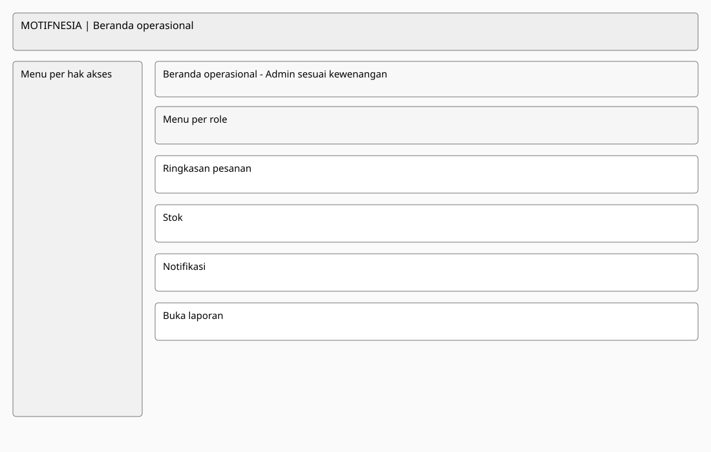
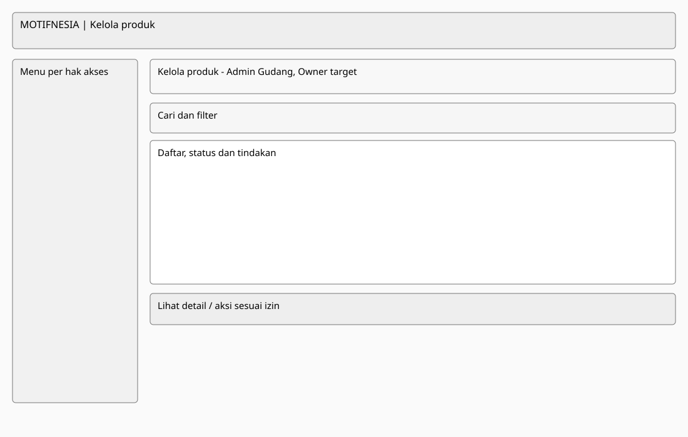
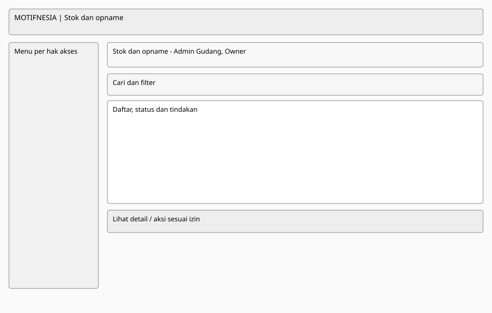
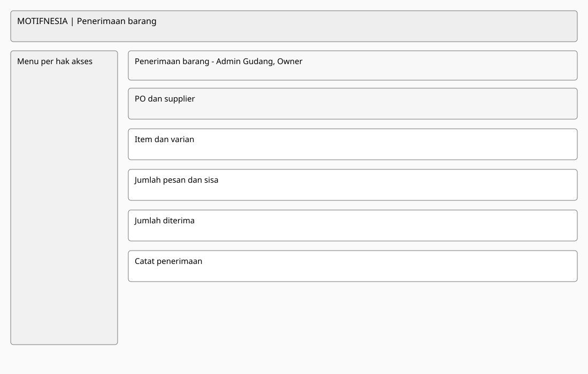
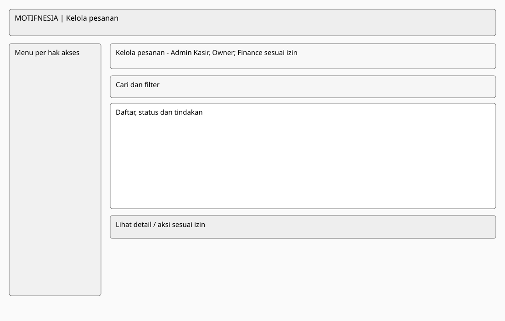
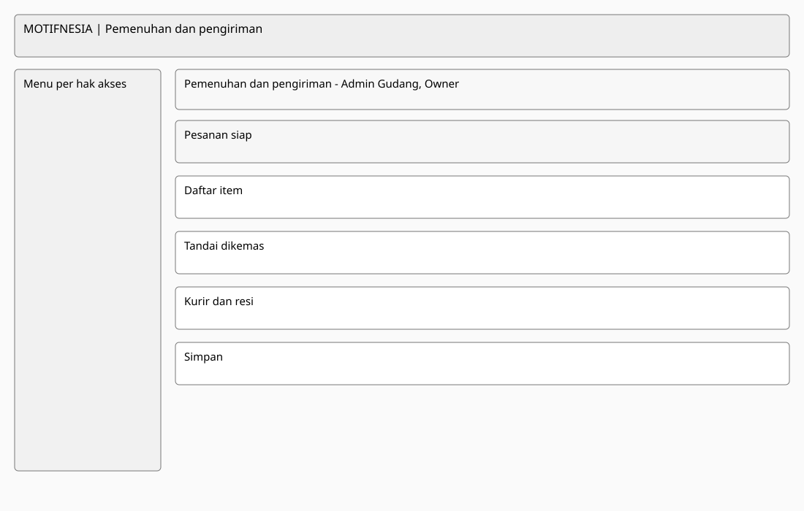
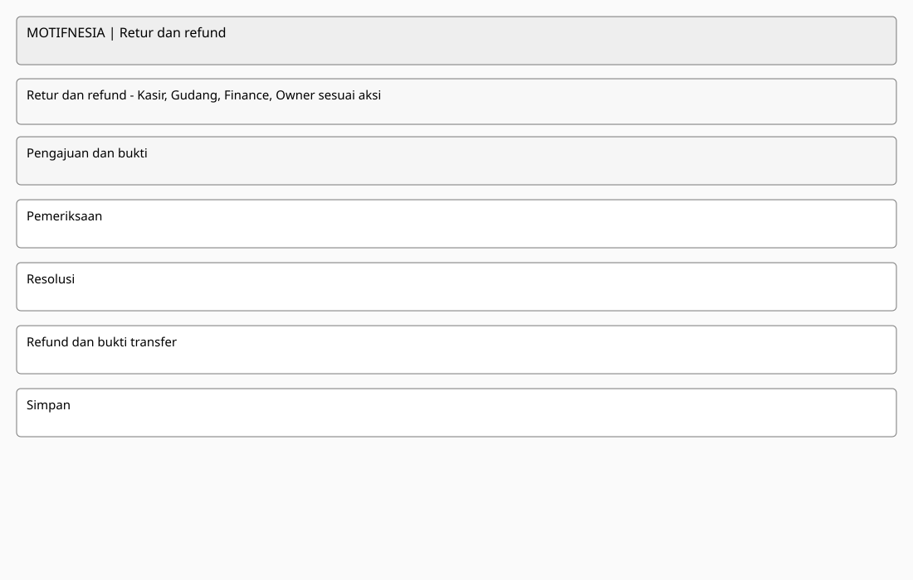
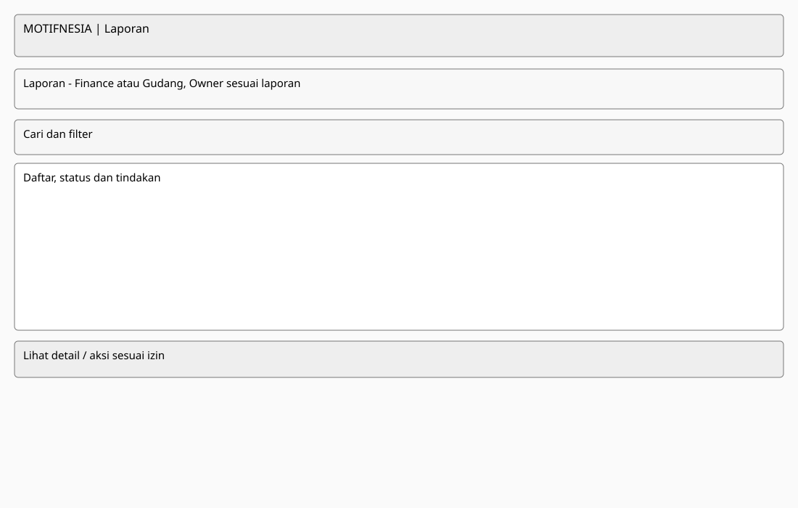

# Wireframe admin - Web

Setiap halaman merupakan rancangan PROPOSED untuk diskusi. Supplier menunjukkan kemampuan aktual atau opsi transisi.

## Beranda operasional

- Role dan tujuan. Admin sesuai kewenangan. Menyelesaikan beranda operasional.
- Use Case. UC-19, UC-34, UC-58, UC-62.
- Elemen dan aksi utama. Menu per role, Ringkasan pesanan, Stok, Notifikasi, Buka laporan.
- Navigasi dan aksi sekunder. Kembali ke daftar atau halaman induk, buka detail atau batalkan sesuai hak akses.
- Normal. Tampilkan data terbaru dan hasil yang telah dikonfirmasi Server.
- Loading. Tampilkan indikator saat memuat atau mengirim dan cegah aksi ganda.
- Empty. Jelaskan data kosong dan sediakan jalur kembali atau reset filter.
- Error. Tampilkan masalah jaringan, izin atau status serta opsi pemulihan yang aman.
- Validasi. Periksa field dan tampilkan pesan dari Server di dekat input yang terkait.
- API. PROPOSED ringkasan terotorisasi, komposisi dan endpoint TBD.

## Kelola produk

- Role dan tujuan. Admin Gudang, Owner target. Menyelesaikan kelola produk.
- Use Case. UC-12, UC-13.
- Elemen dan aksi utama. Cari produk, Daftar dan stok, Tambah, Ubah, Nonaktifkan.
- Navigasi dan aksi sekunder. Kembali ke daftar atau halaman induk, buka detail atau batalkan sesuai hak akses.
- Normal. Tampilkan data terbaru dan hasil yang telah dikonfirmasi Server.
- Loading. Tampilkan indikator saat memuat atau mengirim dan cegah aksi ganda.
- Empty. Jelaskan data kosong dan sediakan jalur kembali atau reset filter.
- Error. Tampilkan masalah jaringan, izin atau status serta opsi pemulihan yang aman.
- Validasi. Periksa field dan tampilkan pesan dari Server di dekat input yang terkait.
- API. GET /admin/product-management; /admin/products/create; hak Gudang target TBD.

## Stok dan opname

- Role dan tujuan. Admin Gudang, Owner. Menyelesaikan stok dan opname.
- Use Case. UC-34, UC-35, UC-36, UC-37, UC-38, UC-63.
- Elemen dan aksi utama. Filter produk, Stok sistem dan fisik, Selisih, Sesuaikan, Riwayat.
- Navigasi dan aksi sekunder. Kembali ke daftar atau halaman induk, buka detail atau batalkan sesuai hak akses.
- Normal. Tampilkan data terbaru dan hasil yang telah dikonfirmasi Server.
- Loading. Tampilkan indikator saat memuat atau mengirim dan cegah aksi ganda.
- Empty. Jelaskan data kosong dan sediakan jalur kembali atau reset filter.
- Error. Tampilkan masalah jaringan, izin atau status serta opsi pemulihan yang aman.
- Validasi. Periksa field dan tampilkan pesan dari Server di dekat input yang terkait.
- API. GET /admin/warehouse; GET /admin/stock-opname; POST /admin/stock-opname/adjust.

## Pengadaan dan PO

- Role dan tujuan. Admin Gudang, Owner. Menyelesaikan pengadaan dan po.
- Use Case. UC-28, UC-29, UC-30, UC-31, UC-32, UC-64.
- Elemen dan aksi utama. Supplier, Daftar pengadaan, Buat PO, Unduh PO, Catat konfirmasi.
- Navigasi dan aksi sekunder. Kembali ke daftar atau halaman induk, buka detail atau batalkan sesuai hak akses.
- Normal. Tampilkan data terbaru dan hasil yang telah dikonfirmasi Server.
- Loading. Tampilkan indikator saat memuat atau mengirim dan cegah aksi ganda.
- Empty. Jelaskan data kosong dan sediakan jalur kembali atau reset filter.
- Error. Tampilkan masalah jaringan, izin atau status serta opsi pemulihan yang aman.
- Validasi. Periksa field dan tampilkan pesan dari Server di dekat input yang terkait.
- API. GET /admin/stock-procurements; POST /admin/stock-procurements; unduh PO PROPOSED TBD.

## Penerimaan barang

- Role dan tujuan. Admin Gudang, Owner. Menyelesaikan penerimaan barang.
- Use Case. UC-33.
- Elemen dan aksi utama. PO dan supplier, Item dan varian, Jumlah pesan dan sisa, Jumlah diterima, Catat penerimaan.
- Navigasi dan aksi sekunder. Kembali ke daftar atau halaman induk, buka detail atau batalkan sesuai hak akses.
- Normal. Tampilkan data terbaru dan hasil yang telah dikonfirmasi Server.
- Loading. Tampilkan indikator saat memuat atau mengirim dan cegah aksi ganda.
- Empty. Jelaskan data kosong dan sediakan jalur kembali atau reset filter.
- Error. Tampilkan masalah jaringan, izin atau status serta opsi pemulihan yang aman.
- Validasi. Periksa field dan tampilkan pesan dari Server di dekat input yang terkait.
- API. GET /admin/stock-procurements/{id}; penerimaan parsial PROPOSED TBD.

## Kelola pesanan

- Role dan tujuan. Admin Kasir, Owner; Finance sesuai izin. Menyelesaikan kelola pesanan.
- Use Case. UC-19, UC-23.
- Elemen dan aksi utama. Filter pesanan, Status order, Status bayar, Lihat rincian, Tindakan berwenang.
- Navigasi dan aksi sekunder. Kembali ke daftar atau halaman induk, buka detail atau batalkan sesuai hak akses.
- Normal. Tampilkan data terbaru dan hasil yang telah dikonfirmasi Server.
- Loading. Tampilkan indikator saat memuat atau mengirim dan cegah aksi ganda.
- Empty. Jelaskan data kosong dan sediakan jalur kembali atau reset filter.
- Error. Tampilkan masalah jaringan, izin atau status serta opsi pemulihan yang aman.
- Validasi. Periksa field dan tampilkan pesan dari Server di dekat input yang terkait.
- API. GET /admin/order-status; POST /admin/order-status/{id}/update.

## Pemenuhan dan pengiriman

- Role dan tujuan. Admin Gudang, Owner. Menyelesaikan pemenuhan dan pengiriman.
- Use Case. UC-24, UC-25.
- Elemen dan aksi utama. Pesanan siap, Daftar item, Tandai dikemas, Kurir dan resi, Simpan.
- Navigasi dan aksi sekunder. Kembali ke daftar atau halaman induk, buka detail atau batalkan sesuai hak akses.
- Normal. Tampilkan data terbaru dan hasil yang telah dikonfirmasi Server.
- Loading. Tampilkan indikator saat memuat atau mengirim dan cegah aksi ganda.
- Empty. Jelaskan data kosong dan sediakan jalur kembali atau reset filter.
- Error. Tampilkan masalah jaringan, izin atau status serta opsi pemulihan yang aman.
- Validasi. Periksa field dan tampilkan pesan dari Server di dekat input yang terkait.
- API. GET /admin/order-status; catat resi target TBD.

## Retur dan refund

- Role dan tujuan. Kasir, Gudang, Finance, Owner sesuai aksi. Menyelesaikan retur dan refund.
- Use Case. UC-41, UC-42, UC-43, UC-44, UC-45.
- Elemen dan aksi utama. Pengajuan dan bukti, Pemeriksaan, Resolusi, Refund dan bukti transfer, Simpan.
- Navigasi dan aksi sekunder. Kembali ke daftar atau halaman induk, buka detail atau batalkan sesuai hak akses.
- Normal. Tampilkan data terbaru dan hasil yang telah dikonfirmasi Server.
- Loading. Tampilkan indikator saat memuat atau mengirim dan cegah aksi ganda.
- Empty. Jelaskan data kosong dan sediakan jalur kembali atau reset filter.
- Error. Tampilkan masalah jaringan, izin atau status serta opsi pemulihan yang aman.
- Validasi. Periksa field dan tampilkan pesan dari Server di dekat input yang terkait.
- API. GET /admin/returns; POST /admin/returns/{id}/update-status; pemeriksaan dan refund target TBD.

## Laporan

- Role dan tujuan. Finance atau Gudang, Owner sesuai laporan. Menyelesaikan laporan.
- Use Case. UC-62, UC-63, UC-64.
- Elemen dan aksi utama. Jenis laporan, Periode, Ringkasan, Tabel, Ekspor.
- Navigasi dan aksi sekunder. Kembali ke daftar atau halaman induk, buka detail atau batalkan sesuai hak akses.
- Normal. Tampilkan data terbaru dan hasil yang telah dikonfirmasi Server.
- Loading. Tampilkan indikator saat memuat atau mengirim dan cegah aksi ganda.
- Empty. Jelaskan data kosong dan sediakan jalur kembali atau reset filter.
- Error. Tampilkan masalah jaringan, izin atau status serta opsi pemulihan yang aman.
- Validasi. Periksa field dan tampilkan pesan dari Server di dekat input yang terkait.
- API. GET /admin/sales-report; GET /admin/sales-report/export; laporan stok dan pengadaan target TBD.

