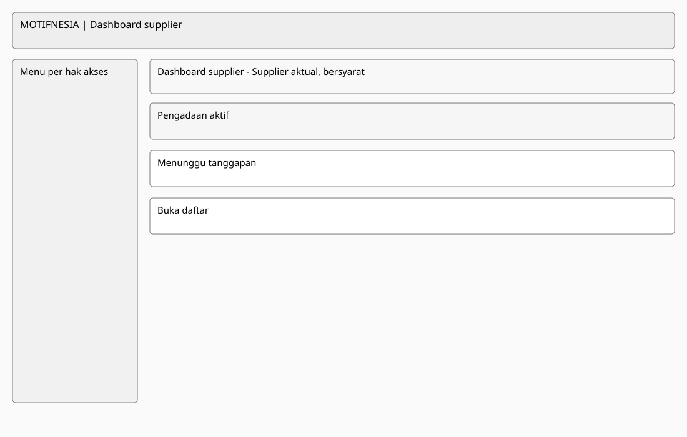
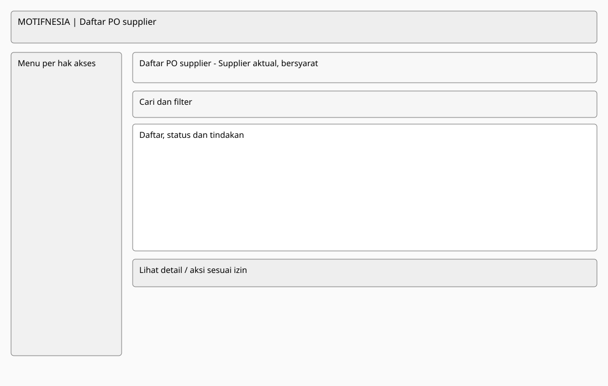
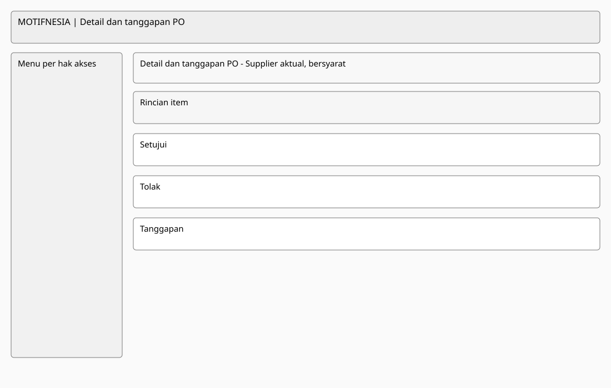
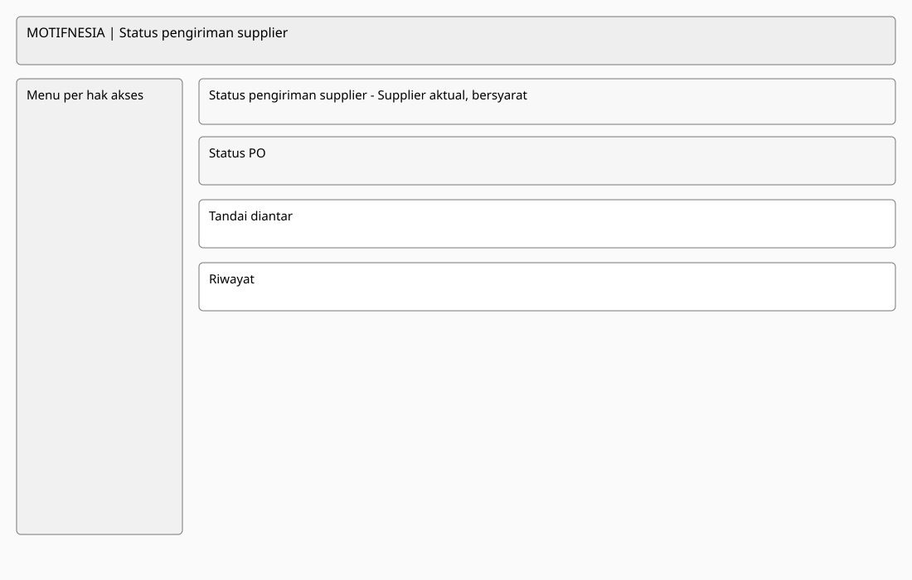

# Wireframe supplier - Web

Setiap halaman merupakan rancangan PROPOSED untuk diskusi. Supplier menunjukkan kemampuan aktual atau opsi transisi.

## Dashboard supplier

- Role dan tujuan. Supplier aktual, bersyarat. Menyelesaikan dashboard supplier.
- Use Case. UC-31, UC-32.
- Elemen dan aksi utama. Pengadaan aktif, Menunggu tanggapan, Buka daftar.
- Navigasi dan aksi sekunder. Kembali ke daftar atau halaman induk, buka detail atau batalkan sesuai hak akses.
- Normal. Tampilkan data terbaru dan hasil yang telah dikonfirmasi Server.
- Loading. Tampilkan indikator saat memuat atau mengirim dan cegah aksi ganda.
- Empty. Jelaskan data kosong dan sediakan jalur kembali atau reset filter.
- Error. Tampilkan masalah jaringan, izin atau status serta opsi pemulihan yang aman.
- Validasi. Periksa field dan tampilkan pesan dari Server di dekat input yang terkait.
- API. GET /supplier/procurements; ringkasan dashboard PROPOSED.

## Daftar PO supplier

- Role dan tujuan. Supplier aktual, bersyarat. Menyelesaikan daftar po supplier.
- Use Case. UC-31, UC-32.
- Elemen dan aksi utama. Daftar PO, Status, Tanggal, Buka rincian.
- Navigasi dan aksi sekunder. Kembali ke daftar atau halaman induk, buka detail atau batalkan sesuai hak akses.
- Normal. Tampilkan data terbaru dan hasil yang telah dikonfirmasi Server.
- Loading. Tampilkan indikator saat memuat atau mengirim dan cegah aksi ganda.
- Empty. Jelaskan data kosong dan sediakan jalur kembali atau reset filter.
- Error. Tampilkan masalah jaringan, izin atau status serta opsi pemulihan yang aman.
- Validasi. Periksa field dan tampilkan pesan dari Server di dekat input yang terkait.
- API. GET /supplier/procurements.

## Detail dan tanggapan PO

- Role dan tujuan. Supplier aktual, bersyarat. Menyelesaikan detail dan tanggapan po.
- Use Case. UC-31, UC-32.
- Elemen dan aksi utama. Rincian item, Setujui, Tolak, Tanggapan.
- Navigasi dan aksi sekunder. Kembali ke daftar atau halaman induk, buka detail atau batalkan sesuai hak akses.
- Normal. Tampilkan data terbaru dan hasil yang telah dikonfirmasi Server.
- Loading. Tampilkan indikator saat memuat atau mengirim dan cegah aksi ganda.
- Empty. Jelaskan data kosong dan sediakan jalur kembali atau reset filter.
- Error. Tampilkan masalah jaringan, izin atau status serta opsi pemulihan yang aman.
- Validasi. Periksa field dan tampilkan pesan dari Server di dekat input yang terkait.
- API. GET /supplier/procurements/{id}; POST /supplier/procurements/{id}/status; penolakan belum dibuktikan.

## Status pengiriman supplier

- Role dan tujuan. Supplier aktual, bersyarat. Menyelesaikan status pengiriman supplier.
- Use Case. UC-32, UC-33.
- Elemen dan aksi utama. Status PO, Tandai diantar, Riwayat.
- Navigasi dan aksi sekunder. Kembali ke daftar atau halaman induk, buka detail atau batalkan sesuai hak akses.
- Normal. Tampilkan data terbaru dan hasil yang telah dikonfirmasi Server.
- Loading. Tampilkan indikator saat memuat atau mengirim dan cegah aksi ganda.
- Empty. Jelaskan data kosong dan sediakan jalur kembali atau reset filter.
- Error. Tampilkan masalah jaringan, izin atau status serta opsi pemulihan yang aman.
- Validasi. Periksa field dan tampilkan pesan dari Server di dekat input yang terkait.
- API. POST /supplier/procurements/{id}/status; pencatatan eksternal admin target TBD.

