# Wireframe customer - Mobile

Setiap halaman merupakan rancangan PROPOSED untuk diskusi. Supplier menunjukkan kemampuan aktual atau opsi transisi.

## Katalog dan pencarian

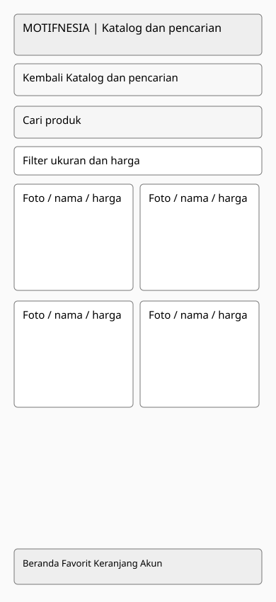

- Role dan tujuan. Guest, Customer. Menyelesaikan katalog dan pencarian.
- Use Case. UC-09, UC-10.
- Elemen dan aksi utama. Pencarian, Filter ukuran dan harga, Kartu produk, Lihat detail.
- Navigasi dan aksi sekunder. Kembali ke daftar atau halaman induk, buka detail atau batalkan sesuai hak akses.
- Normal. Tampilkan data terbaru dan hasil yang telah dikonfirmasi Server.
- Loading. Tampilkan indikator saat memuat atau mengirim dan cegah aksi ganda.
- Empty. Jelaskan data kosong dan sediakan jalur kembali atau reset filter.
- Error. Tampilkan masalah jaringan, izin atau status serta opsi pemulihan yang aman.
- Validasi. Periksa field dan tampilkan pesan dari Server di dekat input yang terkait.
- API. GET /homePage; GET /search/live.

## Detail produk

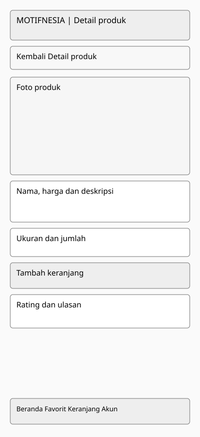

- Role dan tujuan. Guest, Customer. Menyelesaikan detail produk.
- Use Case. UC-11, UC-14, UC-48, UC-50.
- Elemen dan aksi utama. Foto produk, Deskripsi dan harga, Ukuran dan jumlah, Tambah keranjang, Ulasan.
- Navigasi dan aksi sekunder. Kembali ke daftar atau halaman induk, buka detail atau batalkan sesuai hak akses.
- Normal. Tampilkan data terbaru dan hasil yang telah dikonfirmasi Server.
- Loading. Tampilkan indikator saat memuat atau mengirim dan cegah aksi ganda.
- Empty. Jelaskan data kosong dan sediakan jalur kembali atau reset filter.
- Error. Tampilkan masalah jaringan, izin atau status serta opsi pemulihan yang aman.
- Validasi. Periksa field dan tampilkan pesan dari Server di dekat input yang terkait.
- API. GET /products/{id}; POST /cart/add; POST /favorites/store.

## Keranjang

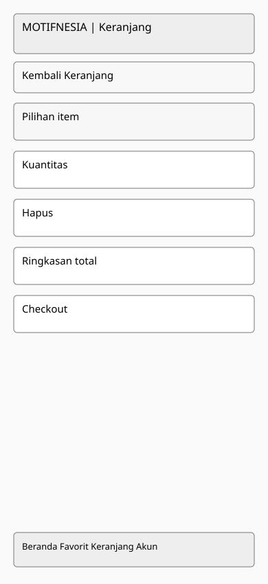

- Role dan tujuan. Customer. Menyelesaikan keranjang.
- Use Case. UC-14, UC-16.
- Elemen dan aksi utama. Pilihan item, Kuantitas, Hapus, Ringkasan total, Checkout.
- Navigasi dan aksi sekunder. Kembali ke daftar atau halaman induk, buka detail atau batalkan sesuai hak akses.
- Normal. Tampilkan data terbaru dan hasil yang telah dikonfirmasi Server.
- Loading. Tampilkan indikator saat memuat atau mengirim dan cegah aksi ganda.
- Empty. Jelaskan data kosong dan sediakan jalur kembali atau reset filter.
- Error. Tampilkan masalah jaringan, izin atau status serta opsi pemulihan yang aman.
- Validasi. Periksa field dan tampilkan pesan dari Server di dekat input yang terkait.
- API. GET /cart; POST /cart/update; POST /cart/checkout.

## Checkout

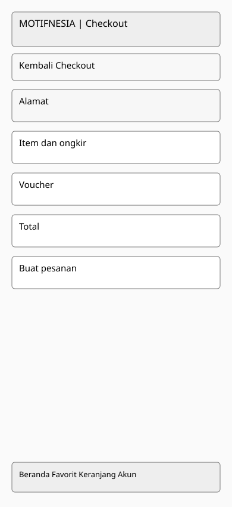

- Role dan tujuan. Customer. Menyelesaikan checkout.
- Use Case. UC-15, UC-16.
- Elemen dan aksi utama. Alamat, Item dan ongkir, Voucher, Total, Buat pesanan.
- Navigasi dan aksi sekunder. Kembali ke daftar atau halaman induk, buka detail atau batalkan sesuai hak akses.
- Normal. Tampilkan data terbaru dan hasil yang telah dikonfirmasi Server.
- Loading. Tampilkan indikator saat memuat atau mengirim dan cegah aksi ganda.
- Empty. Jelaskan data kosong dan sediakan jalur kembali atau reset filter.
- Error. Tampilkan masalah jaringan, izin atau status serta opsi pemulihan yang aman.
- Validasi. Periksa field dan tampilkan pesan dari Server di dekat input yang terkait.
- API. GET /checkout; POST /checkout/store; kontrak reservasi target TBD.

## Pembayaran gateway

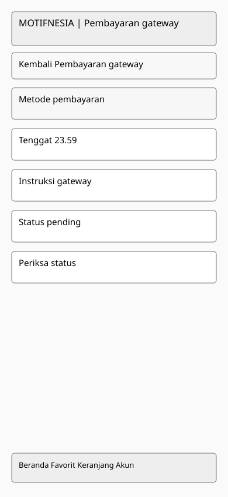

- Role dan tujuan. Customer. Menyelesaikan pembayaran gateway.
- Use Case. UC-20, UC-23.
- Elemen dan aksi utama. Metode pembayaran, Tenggat 23.59, Instruksi gateway, Status pending, Periksa status.
- Navigasi dan aksi sekunder. Kembali ke daftar atau halaman induk, buka detail atau batalkan sesuai hak akses.
- Normal. Tampilkan data terbaru dan hasil yang telah dikonfirmasi Server.
- Loading. Tampilkan indikator saat memuat atau mengirim dan cegah aksi ganda.
- Empty. Jelaskan data kosong dan sediakan jalur kembali atau reset filter.
- Error. Tampilkan masalah jaringan, izin atau status serta opsi pemulihan yang aman.
- Validasi. Periksa field dan tampilkan pesan dari Server di dekat input yang terkait.
- API. GET /payment dan POST /payment/store berlaku untuk transfer manual; gateway PROPOSED, endpoint TBD.

## Daftar pesanan

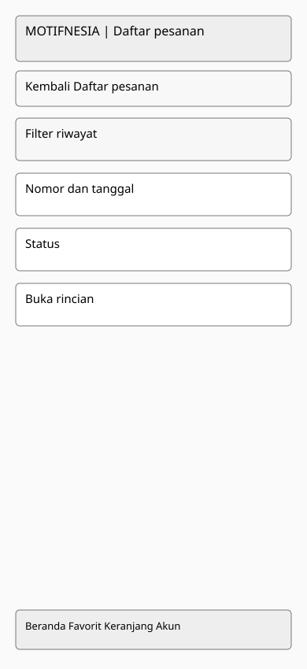

- Role dan tujuan. Customer. Menyelesaikan daftar pesanan.
- Use Case. UC-17.
- Elemen dan aksi utama. Filter riwayat, Nomor dan tanggal, Status, Buka rincian.
- Navigasi dan aksi sekunder. Kembali ke daftar atau halaman induk, buka detail atau batalkan sesuai hak akses.
- Normal. Tampilkan data terbaru dan hasil yang telah dikonfirmasi Server.
- Loading. Tampilkan indikator saat memuat atau mengirim dan cegah aksi ganda.
- Empty. Jelaskan data kosong dan sediakan jalur kembali atau reset filter.
- Error. Tampilkan masalah jaringan, izin atau status serta opsi pemulihan yang aman.
- Validasi. Periksa field dan tampilkan pesan dari Server di dekat input yang terkait.
- API. GET /profile menyediakan riwayat.

## Detail pesanan dan pengiriman

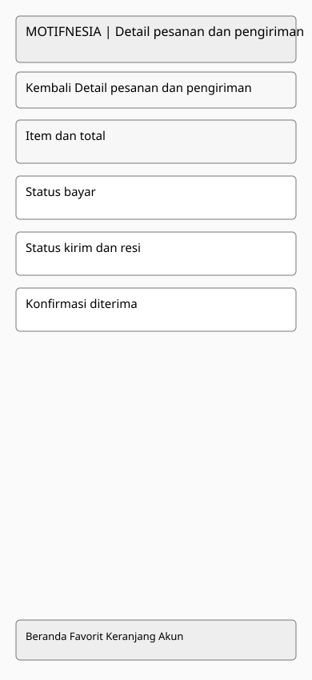

- Role dan tujuan. Customer. Menyelesaikan detail pesanan dan pengiriman.
- Use Case. UC-18, UC-26, UC-27.
- Elemen dan aksi utama. Item dan total, Status bayar, Status kirim dan resi, Konfirmasi diterima.
- Navigasi dan aksi sekunder. Kembali ke daftar atau halaman induk, buka detail atau batalkan sesuai hak akses.
- Normal. Tampilkan data terbaru dan hasil yang telah dikonfirmasi Server.
- Loading. Tampilkan indikator saat memuat atau mengirim dan cegah aksi ganda.
- Empty. Jelaskan data kosong dan sediakan jalur kembali atau reset filter.
- Error. Tampilkan masalah jaringan, izin atau status serta opsi pemulihan yang aman.
- Validasi. Periksa field dan tampilkan pesan dari Server di dekat input yang terkait.
- API. GET /transaction/success/{id}; POST /orders/{order}/confirm-arrived; resi target TBD.

## Retur dan penukaran

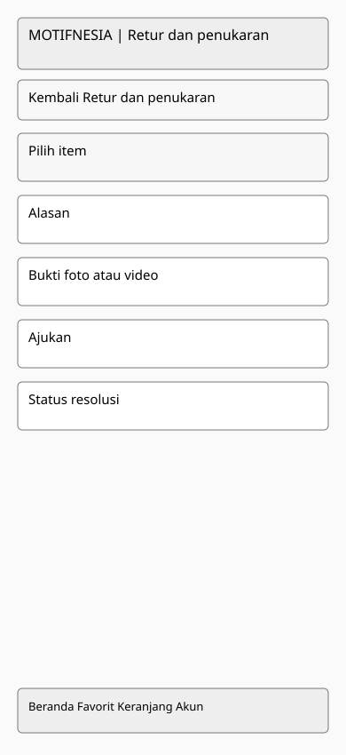

- Role dan tujuan. Customer. Menyelesaikan retur dan penukaran.
- Use Case. UC-39, UC-40, UC-46.
- Elemen dan aksi utama. Pilih item, Alasan, Bukti foto atau video, Ajukan, Status resolusi.
- Navigasi dan aksi sekunder. Kembali ke daftar atau halaman induk, buka detail atau batalkan sesuai hak akses.
- Normal. Tampilkan data terbaru dan hasil yang telah dikonfirmasi Server.
- Loading. Tampilkan indikator saat memuat atau mengirim dan cegah aksi ganda.
- Empty. Jelaskan data kosong dan sediakan jalur kembali atau reset filter.
- Error. Tampilkan masalah jaringan, izin atau status serta opsi pemulihan yang aman.
- Validasi. Periksa field dan tampilkan pesan dari Server di dekat input yang terkait.
- API. GET /returns; POST /returns; video dan status resolusi target TBD.

## Profil dan alamat

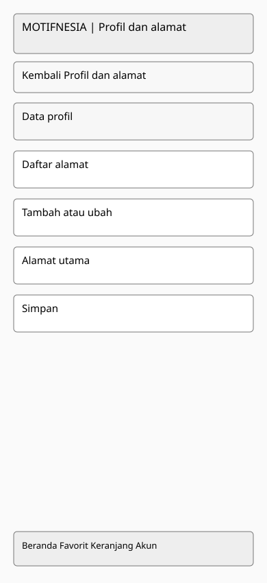

- Role dan tujuan. Customer. Menyelesaikan profil dan alamat.
- Use Case. UC-05, UC-06, UC-15.
- Elemen dan aksi utama. Data profil, Daftar alamat, Tambah atau ubah, Alamat utama, Simpan.
- Navigasi dan aksi sekunder. Kembali ke daftar atau halaman induk, buka detail atau batalkan sesuai hak akses.
- Normal. Tampilkan data terbaru dan hasil yang telah dikonfirmasi Server.
- Loading. Tampilkan indikator saat memuat atau mengirim dan cegah aksi ganda.
- Empty. Jelaskan data kosong dan sediakan jalur kembali atau reset filter.
- Error. Tampilkan masalah jaringan, izin atau status serta opsi pemulihan yang aman.
- Validasi. Periksa field dan tampilkan pesan dari Server di dekat input yang terkait.
- API. GET /profile; POST /profile/edit; /profile/addresses.

## Membership dan voucher

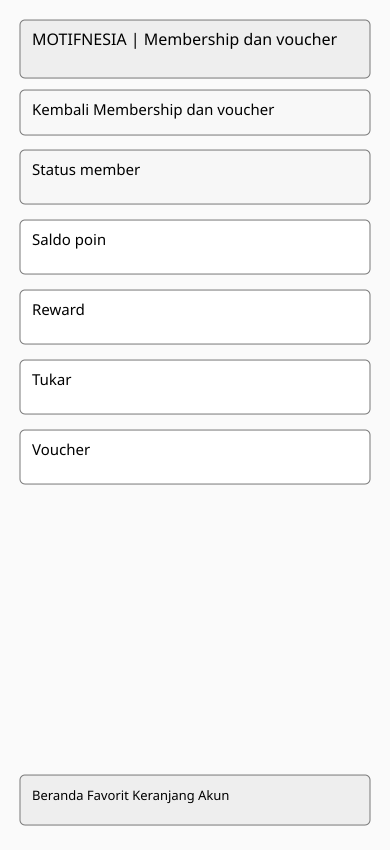

- Role dan tujuan. Customer. Menyelesaikan membership dan voucher.
- Use Case. UC-52, UC-53, UC-54.
- Elemen dan aksi utama. Status member, Saldo poin, Reward, Tukar, Voucher.
- Navigasi dan aksi sekunder. Kembali ke daftar atau halaman induk, buka detail atau batalkan sesuai hak akses.
- Normal. Tampilkan data terbaru dan hasil yang telah dikonfirmasi Server.
- Loading. Tampilkan indikator saat memuat atau mengirim dan cegah aksi ganda.
- Empty. Jelaskan data kosong dan sediakan jalur kembali atau reset filter.
- Error. Tampilkan masalah jaringan, izin atau status serta opsi pemulihan yang aman.
- Validasi. Periksa field dan tampilkan pesan dari Server di dekat input yang terkait.
- API. GET /membership; POST /membership/redeem/{reward}; GET /membership/vouchers.

## Notifikasi

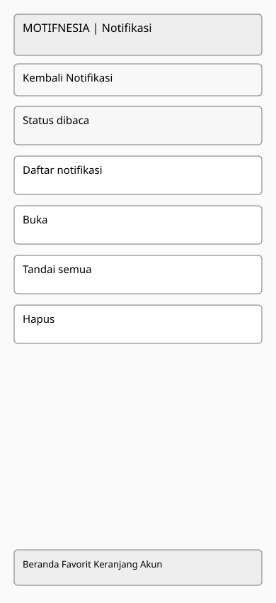

- Role dan tujuan. Customer. Menyelesaikan notifikasi.
- Use Case. UC-58, UC-59.
- Elemen dan aksi utama. Status dibaca, Daftar notifikasi, Buka, Tandai semua, Hapus.
- Navigasi dan aksi sekunder. Kembali ke daftar atau halaman induk, buka detail atau batalkan sesuai hak akses.
- Normal. Tampilkan data terbaru dan hasil yang telah dikonfirmasi Server.
- Loading. Tampilkan indikator saat memuat atau mengirim dan cegah aksi ganda.
- Empty. Jelaskan data kosong dan sediakan jalur kembali atau reset filter.
- Error. Tampilkan masalah jaringan, izin atau status serta opsi pemulihan yang aman.
- Validasi. Periksa field dan tampilkan pesan dari Server di dekat input yang terkait.
- API. GET /notifications; POST /notifications/mark-all-read; hapus Customer target TBD.

