# 3.3 Perancangan Antarmuka Pengguna Client Mobile

Dokumentasi ini mencatat kondisi **AS-IMPLEMENTED** aplikasi Flutter yang diperiksa pada 24 November 2026. Observasi dilakukan pada Flutter Web dengan viewport 390 × 844 piksel dan backend Laravel lokal. Layar publik diuji sebagai **Guest**, sedangkan layar terlindungi mula-mula diuji dengan akun **Customer** dari seeder Server. Untuk publikasi, lima tangkapan layar (08, 11, 12, 14, dan 15) diambil ulang langsung dari aplikasi dengan identitas, alamat, dan pesanan demonstrasi pada database SQLite terisolasi. Keadaan Keranjang, Checkout, dan Pembayaran tetap berasal dari pemeriksaan awal.

### 3.3.1 Halaman Login

Halaman Login menyediakan autentikasi bagi Guest yang akan menggunakan fitur Customer. Antarmuka ini meminta identitas akun dan sandi, serta menyediakan navigasi menuju registrasi, pengaturan ulang sandi, dan katalog. Halaman juga muncul ketika Guest membuka route yang memerlukan sesi Customer.

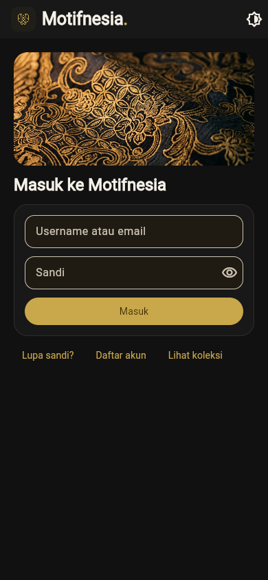

*Gambar 3.xx Tampilan Halaman Login*

Berdasarkan tampilan pada Gambar 3.xx, halaman Login terdiri atas beberapa komponen antarmuka yang digunakan untuk memasukkan kredensial akun. Komponen tersebut meliputi:

1. **Identitas MotifNesia dan gambar batik**, menandai aplikasi dan memberi konteks visual pada formulir autentikasi.
2. **Kolom Username atau email**, menerima identitas akun yang akan diperiksa oleh backend.
3. **Kolom Sandi dan ikon visibilitas**, menerima sandi serta memungkinkan pengguna menampilkan atau menyembunyikan isinya.
4. **Tombol Masuk**, mengirim formulir setelah pemeriksaan kolom wajib pada sisi aplikasi.
5. **Tautan Lupa sandi?, Daftar akun, dan Lihat koleksi**, membuka alur pemulihan, pendaftaran, atau katalog publik.
6. **Ikon ganti tema**, mengubah tema tampilan aplikasi.

Guest dapat mengisi dua kolom dan menekan Masuk. Berdasarkan kode `SessionController`, aplikasi mengirim `POST /login` ke backend, menyimpan token sesi setelah respons berhasil, kemudian membuka halaman tujuan atau beranda sesuai peran. Login dengan akun Customer seeder berhasil pada pemeriksaan lanjutan. Customer dapat membuka Keranjang dan Profil setelah masuk.

### 3.3.2 Halaman Registrasi Akun

Halaman Registrasi Akun ditujukan kepada Guest yang hendak membuat akun Customer. Formulir mengumpulkan identitas dasar, sandi, serta pertanyaan dan jawaban keamanan yang diperlukan oleh alur pendaftaran pada implementasi saat ini.

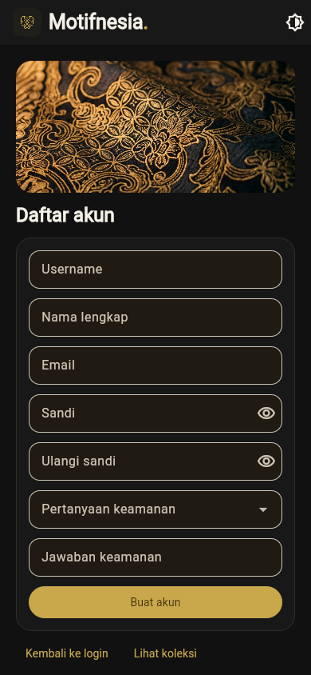

*Gambar 3.xx Tampilan Halaman Registrasi Akun*

Berdasarkan tampilan pada Gambar 3.xx, halaman Registrasi Akun terdiri atas beberapa komponen antarmuka yang digunakan untuk mengumpulkan data pendaftaran. Komponen tersebut meliputi:

1. **Kolom Username, Nama lengkap, dan Email**, menerima identitas akun; Nama lengkap ditandai opsional pada definisi formulir.
2. **Kolom Sandi dan Ulangi sandi**, menerima sandi serta konfirmasinya; ikon mata mengatur visibilitas input sandi.
3. **Pilihan Pertanyaan keamanan dan kolom Jawaban keamanan**, menerima pasangan pertanyaan dan jawaban yang juga dipakai dalam alur pengaturan ulang sandi.
4. **Tombol Buat akun**, memulai pengiriman data pendaftaran setelah validasi kolom wajib.
5. **Tautan Kembali ke login dan Lihat koleksi**, membuka halaman autentikasi atau katalog tanpa membuat akun.

Guest mengisi formulir lalu memilih Buat akun. Kode mengirim `POST /register` ke backend, menampilkan pesan respons apabila tersedia, lalu berpindah ke Login ketika permintaan berhasil. Pendaftaran aktual **tidak dijalankan** agar tidak membuat akun pada database proyek; keberhasilan dan pesan backend belum diverifikasi melalui interaksi.

### 3.3.3 Halaman Atur Ulang Sandi

Halaman Atur Ulang Sandi memberi Guest jalur pemulihan akses melalui identitas akun, pertanyaan keamanan, jawaban, dan sandi baru. Implementasi yang terlihat menggunakan formulir langsung pada aplikasi, bukan alur tautan surel.

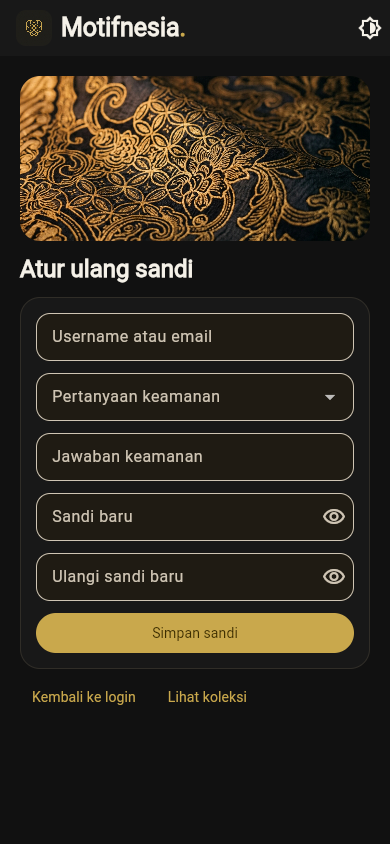

*Gambar 3.xx Tampilan Halaman Atur Ulang Sandi*

Berdasarkan tampilan pada Gambar 3.xx, halaman Atur Ulang Sandi terdiri atas beberapa komponen antarmuka yang digunakan untuk meminta perubahan sandi. Komponen tersebut meliputi:

1. **Kolom Username atau email**, menentukan akun yang sandinya hendak diubah.
2. **Pilihan Pertanyaan keamanan dan kolom Jawaban keamanan**, menerima data verifikasi yang ditetapkan pada proses pendaftaran.
3. **Kolom Sandi baru dan Ulangi sandi baru**, menerima sandi pengganti dan konfirmasinya; ikon mata mengatur tampilan karakter.
4. **Tombol Simpan sandi**, mengirim data formulir setelah pemeriksaan kolom wajib.
5. **Tautan Kembali ke login dan Lihat koleksi**, menyediakan jalan kembali ke autentikasi atau katalog.

Guest mengisi identitas, jawaban keamanan, dan sandi baru sebelum memilih Simpan sandi. Berdasarkan kode, aplikasi mengirim `POST /forgot` dan kembali ke Login setelah respons berhasil; kesalahan pengiriman ditampilkan oleh komponen formulir. Perubahan sandi **tidak diuji** karena memerlukan akun dan jawaban keamanan yang sah.

### 3.3.4 Halaman Katalog Produk

Halaman Katalog Produk merupakan titik awal penelusuran batik bagi Guest dan Customer. Pada pemeriksaan ini, backend mengembalikan 19 produk. Antarmuka memadukan materi promosi, pintasan kategori, dan kartu produk yang mengarah ke rincian barang.

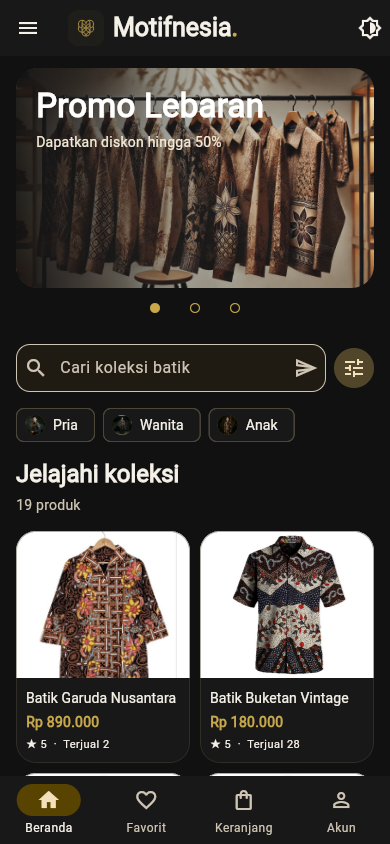

*Gambar 3.xx Tampilan Halaman Katalog Produk*

Berdasarkan tampilan pada Gambar 3.xx, halaman Katalog Produk terdiri atas beberapa komponen antarmuka yang digunakan untuk menelusuri koleksi. Komponen tersebut meliputi:

1. **Banner promosi dan indikator slide**, menampilkan materi promosi yang diterima halaman katalog dari backend.
2. **Kotak pencarian dan tombol filter**, menyediakan pencarian teks serta pembukaan pilihan penyaringan produk.
3. **Pintasan kategori Pria, Wanita, dan Anak**, memulai penyaringan berdasarkan kategori yang dipilih.
4. **Judul Jelajahi koleksi dan jumlah produk**, memberi konteks daftar yang sedang ditampilkan; angka 19 merupakan hasil respons saat pemeriksaan.
5. **Kartu produk**, menampilkan foto, nama, harga, rating, dan jumlah terjual; sentuhan pada kartu membuka Detail Produk.
6. **Navigasi bawah**, menyediakan akses Beranda, Favorit, Keranjang, dan Akun. Route selain Beranda yang memerlukan Customer akan menampilkan Login bagi Guest.

Guest membuka katalog dan aplikasi meminta data melalui `GET /homePage` pada API. Produk serta materi promosi kemudian ditampilkan dari respons backend. Kartu produk dapat dipilih untuk membuka route `/products/:id`; pada pemeriksaan ini produk ber-ID 19 berhasil dibuka. Pencarian dan filter berada di dalam halaman katalog yang sama, sebagaimana dijelaskan pada subbab berikut.

### 3.3.5 Halaman Pencarian dan Filter Produk

Pencarian dan Filter Produk merupakan keadaan tersaring dari Katalog Produk, bukan route tersendiri. Guest dan Customer dapat mempersempit koleksi melalui masukan pencarian, kategori, jenis lengan, dan rentang harga. Tangkapan hasil berikut memuat parameter kategori `Pria` dan menampilkan 11 produk dari respons backend.

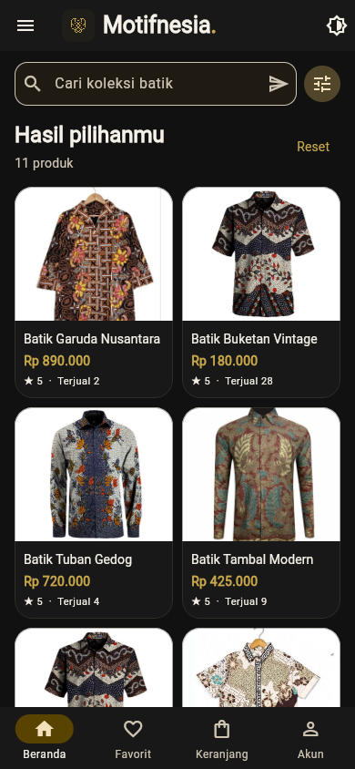

*Gambar 3.xx Tampilan Hasil Pencarian dan Filter Produk*

Berdasarkan tampilan pada Gambar 3.xx, halaman Pencarian dan Filter Produk terdiri atas beberapa komponen antarmuka yang digunakan untuk melihat hasil penyaringan koleksi. Komponen tersebut meliputi:

1. **Kotak Cari koleksi batik**, menerima kata kunci; kode menyediakan saran langsung melalui `GET /search/live` setelah input minimal dua karakter.
2. **Tombol filter**, membuka panel pilihan penyaringan.
3. **Judul Hasil pilihanmu, jumlah produk, dan tombol Reset**, menandai filter aktif, menyajikan jumlah hasil, dan mengembalikan daftar tanpa filter.
4. **Kartu hasil**, menampilkan foto, nama, harga, rating, serta jumlah terjual dari produk yang cocok dan dapat dibuka ke rincian produk.

Pada pemeriksaan ini, route katalog dimuat dengan parameter `gender=Pria`; aplikasi meneruskan parameter tersebut ke `GET /homePage` dan menampilkan 11 produk. Fungsi pencarian teks dan penekanan Reset teridentifikasi pada kode tetapi belum diuji melalui input pada sesi ini. Tombol filter berhasil dibuka dan tampilan panelnya tercatat pada gambar berikut.

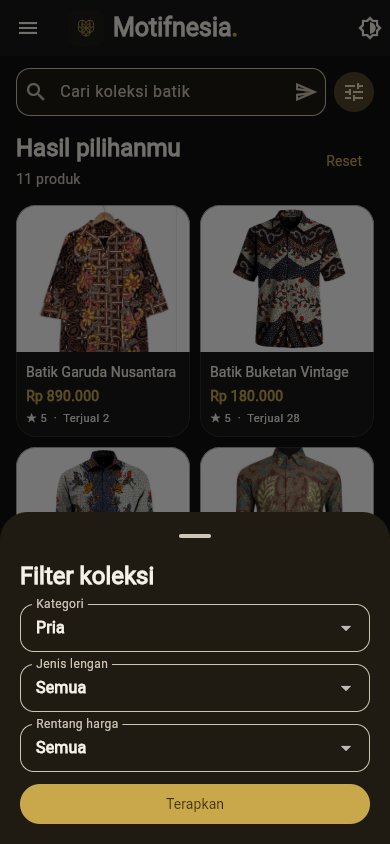

*Gambar 3.xx Tampilan Panel Filter Koleksi*

Berdasarkan tampilan pada Gambar 3.xx, halaman Pencarian dan Filter Produk terdiri atas beberapa komponen antarmuka yang digunakan untuk memilih kriteria penyaringan. Komponen tersebut meliputi:

1. **Pilihan Kategori**, memperlihatkan nilai Pria yang sedang aktif dan menyediakan pilihan kategori lain dari opsi respons backend.
2. **Pilihan Jenis lengan**, menyediakan penyaringan berdasarkan jenis lengan; nilai pada tangkapan adalah Semua.
3. **Pilihan Rentang harga**, menyediakan penyaringan berdasarkan rentang harga; nilai pada tangkapan adalah Semua.
4. **Tombol Terapkan**, mengirim pilihan ke keadaan katalog untuk memuat ulang hasil.

Pengguna dapat membuka panel melalui ikon filter, memilih kriteria, lalu menekan Terapkan. Kode menutup panel dan memanggil ulang `GET /homePage` dengan parameter kategori, jenis lengan, serta rentang harga yang dipilih; hasilnya ditampilkan pada daftar katalog. Pembukaan panel berhasil diuji, sedangkan penekanan Terapkan setelah perubahan pilihan belum diuji.

### 3.3.6 Halaman Detail Produk

Halaman Detail Produk memberi Guest dan Customer informasi barang yang lebih rinci sebelum menentukan tindakan pembelian. Pemeriksaan berhasil membuka produk “Batik Garuda Nusantara” ber-ID 19 dari katalog. Bagian atas halaman menyajikan foto, kategori, harga, serta pilihan ukuran dan tindakan terkait produk.

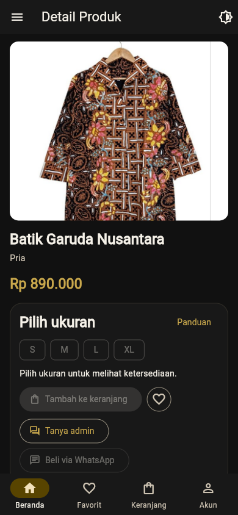

*Gambar 3.xx Tampilan Halaman Detail Produk*

Berdasarkan tampilan pada Gambar 3.xx, halaman Detail Produk terdiri atas beberapa komponen antarmuka yang digunakan untuk memeriksa produk dan memilih varian. Komponen tersebut meliputi:

1. **Foto produk**, menampilkan gambar barang; kode memungkinkan gambar dibuka dalam dialog yang dapat diperbesar.
2. **Nama, kategori, dan harga**, mengidentifikasi produk serta harga yang dikembalikan backend.
3. **Pilihan ukuran S, M, L, dan XL**, menampilkan varian; tombol hanya aktif jika stok ukuran pada respons lebih dari nol. Pada tangkapan, semua pilihan tampak tidak aktif.
4. **Teks ketersediaan dan tombol Panduan**, menjelaskan bahwa ukuran perlu dipilih untuk melihat stok dan menyediakan panduan ukuran.
5. **Tombol Tambah ke keranjang dan ikon favorit**, menyediakan tindakan pembelian dan penyimpanan favorit; penambahan memerlukan ukuran serta sesi Customer.
6. **Tombol Tanya admin dan Beli via WhatsApp**, menyediakan alur pertanyaan produk dan tautan pembelian eksternal; tombol WhatsApp menunggu pemilihan ukuran.

Guest membuka kartu produk, lalu aplikasi mengambil detail melalui `GET /products/19`. Pengguna dapat melihat harga dan stok varian yang dikirim backend. Jika ukuran yang tersedia dipilih, kode mengaktifkan penambahan ke keranjang; bagi Guest tindakan tersebut membuka Login. Aksi pembelian, favorit, chat, dan WhatsApp **tidak dijalankan** pada pemeriksaan ini. Bagian deskripsi, ulasan, dan produk terkait ada pada kode di bawah area layar yang ditangkap, sehingga tidak diklaim telah terlihat pada gambar.

### 3.3.7 Halaman Keranjang Belanja

Halaman Keranjang Belanja digunakan Customer untuk meninjau produk yang disiapkan sebelum Checkout. Pada akun seeder yang diperiksa, keranjang kosong sehingga aplikasi menampilkan keadaan kosong, bukan daftar produk. Route ini memerlukan autentikasi; pembukaan oleh Guest telah terbukti menampilkan Login.

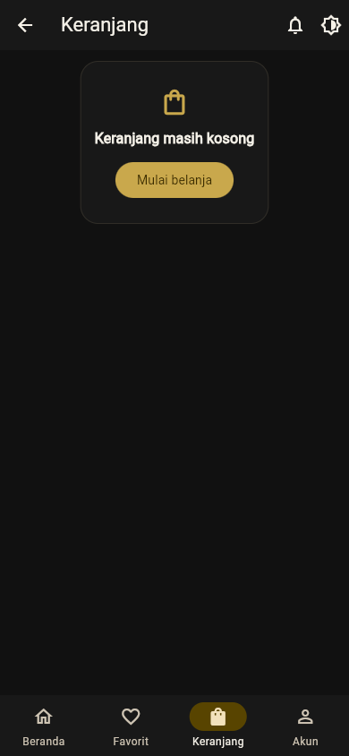

*Gambar 3.xx Tampilan Halaman Keranjang Belanja*

Berdasarkan tampilan pada Gambar 3.xx, halaman Keranjang Belanja terdiri atas beberapa komponen antarmuka yang digunakan untuk menunjukkan keadaan keranjang Customer. Komponen tersebut meliputi:

1. **Judul Keranjang dan tombol kembali**, mengidentifikasi halaman serta menyediakan navigasi ke layar sebelumnya.
2. **Ikon dan pesan Keranjang masih kosong**, menjelaskan bahwa belum ada item yang dapat diproses pada akun yang digunakan.
3. **Tombol Mulai belanja**, mengarahkan Customer kembali ke katalog menurut kode halaman.
4. **Navigasi bawah**, menyediakan akses Beranda, Favorit, Keranjang, dan Akun.

Saat Customer membuka `/cart`, aplikasi meminta data keranjang dari backend dan menampilkan pesan kosong berdasarkan respons yang diterima. Menurut kode, apabila terdapat item, halaman juga menyediakan pilihan item, perubahan jumlah, penghapusan, dan tombol Checkout. Keadaan berisi item serta tindakan tersebut belum diuji; tidak ada produk yang ditambahkan hanya untuk mengubah tampilan screenshot.

### 3.3.8 Halaman Alamat Pengiriman

Pengelolaan Alamat Pengiriman berada di dalam Edit Profil, bukan pada route tersendiri. Customer dapat membuka formulir Tambah alamat melalui tombol tambah pada bagian Alamat. Formulir ini mengumpulkan tujuan pengiriman dan kontak penerima yang diperlukan oleh proses belanja.

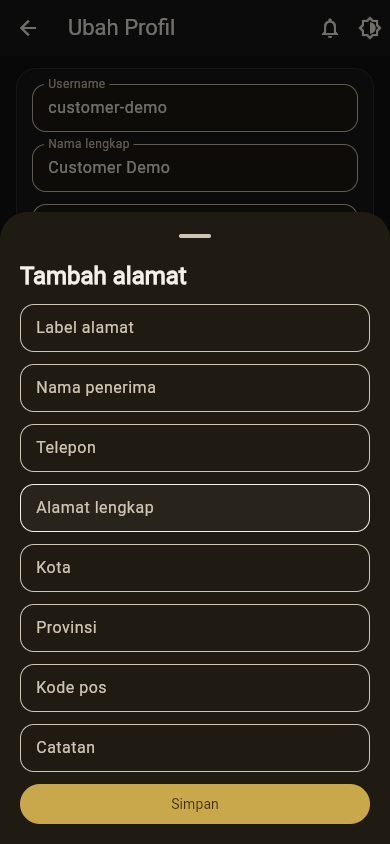

*Gambar 3.xx Tampilan Formulir Alamat Pengiriman*

Berdasarkan tampilan pada Gambar 3.xx, halaman Alamat Pengiriman terdiri atas beberapa komponen antarmuka yang digunakan untuk memasukkan alamat tujuan Customer. Komponen tersebut meliputi:

1. **Judul Tambah alamat**, menunjukkan bahwa panel merupakan formulir alamat baru di atas Edit Profil.
2. **Kolom Label alamat dan Nama penerima**, mengidentifikasi alamat serta penerima barang.
3. **Kolom Telepon dan Alamat lengkap**, menerima kontak penerima dan rincian tujuan.
4. **Kolom Kota, Provinsi, dan Kode pos**, melengkapi wilayah tujuan pengiriman.
5. **Kolom Catatan**, menerima keterangan tambahan yang bersifat opsional menurut kode.
6. **Tombol Simpan**, mengirim formulir setelah kolom wajib terisi.

Customer membuka Edit Profil, menekan tombol tambah pada bagian Alamat, lalu aplikasi menampilkan panel pada gambar. Berdasarkan `AddressCards`, penyimpanan akan mengirim `POST /profile/addresses` dan memuat ulang daftar alamat setelah respons berhasil. Pembukaan panel telah diuji, tetapi penyimpanan tidak dilakukan sehingga hasil validasi backend dan perubahan daftar belum diverifikasi. Checkout juga memiliki kolom alamat dan tautan Kelola alamat ke Edit Profil menurut kode.

### 3.3.9 Halaman Checkout

Halaman Checkout merupakan tahap penyusunan pesanan bagi Customer setelah memilih item keranjang. Pada akun seeder yang diuji, tidak ada item terpilih sehingga backend menolak menampilkan formulir Checkout dan aplikasi menyajikan pesan keadaan tersebut. Screenshot berikut mendokumentasikan kondisi yang benar-benar terjadi.

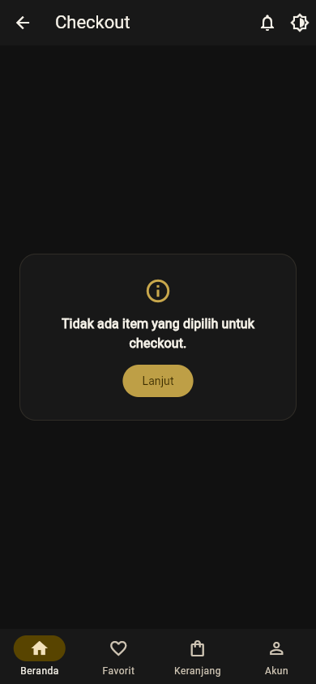

*Gambar 3.xx Tampilan Halaman Checkout tanpa Item Terpilih*

Berdasarkan tampilan pada Gambar 3.xx, halaman Checkout terdiri atas beberapa komponen antarmuka yang digunakan untuk memberi tahu Customer bahwa pesanan belum dapat dilanjutkan. Komponen tersebut meliputi:

1. **Judul Checkout dan tombol kembali**, menunjukkan tahap transaksi serta menyediakan navigasi kembali.
2. **Ikon informasi dan pesan tidak ada item terpilih**, menyampaikan alasan formulir Checkout belum ditampilkan.
3. **Tombol Lanjut**, mengikuti tujuan pengalihan yang diberikan backend sebagaimana ditangani oleh `ApiPageState`.
4. **Navigasi bawah**, menyediakan akses ke Beranda, Favorit, Keranjang, dan Akun.

Customer membuka `/checkout`; aplikasi mengirim permintaan data ke backend, lalu menerima kondisi tidak ada item terpilih dan menampilkan pesan pada gambar. Tombol Lanjut dapat digunakan untuk mengikuti pengalihan dari respons backend, tetapi tidak ditekan pada pemeriksaan ini. Kode menyediakan formulir item, alamat, metode pengiriman, metode pembayaran, voucher, dan estimasi total ketika data Checkout tersedia; keadaan tersebut belum berhasil ditampilkan.

### 3.3.10 Halaman Pembayaran

Halaman Pembayaran digunakan Customer setelah data Checkout terbentuk. Dalam pengujian ini, backend tidak menemukan data Checkout aktif sehingga aplikasi menampilkan pesan untuk mengulang Checkout. Kondisi ini dicatat apa adanya; tidak dibuat pesanan baru dan tidak dilakukan pembayaran.

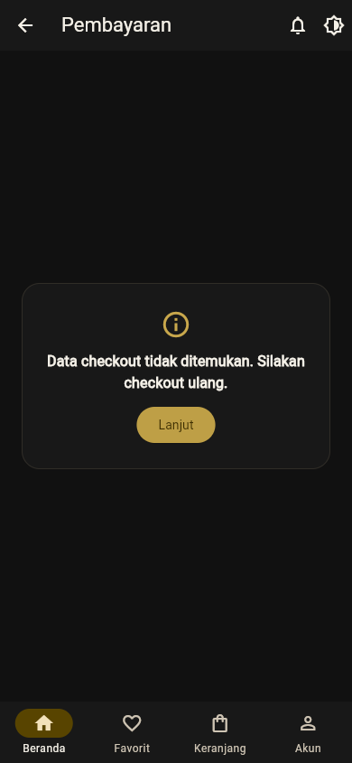

*Gambar 3.xx Tampilan Halaman Pembayaran tanpa Data Checkout*

Berdasarkan tampilan pada Gambar 3.xx, halaman Pembayaran terdiri atas beberapa komponen antarmuka yang digunakan untuk menjelaskan kegagalan prasyarat pembayaran. Komponen tersebut meliputi:

1. **Judul Pembayaran dan tombol kembali**, mengidentifikasi halaman serta menyediakan navigasi ke tahap sebelumnya.
2. **Ikon informasi dan pesan data checkout tidak ditemukan**, menerangkan bahwa rincian transaksi belum dapat ditampilkan.
3. **Tombol Lanjut**, mengikuti pengalihan yang disediakan respons backend menurut penanganan kesalahan pada kode.
4. **Navigasi bawah**, menyediakan akses ke halaman utama Customer.

Customer membuka `/payment`; aplikasi meminta data pembayaran ke backend. Karena tidak ada Checkout aktif, respons menghasilkan pesan pada gambar. Menurut kode, ketika data tersedia halaman menampilkan metode, batas waktu, subtotal, ongkos kirim, total, nomor pembayaran, dan pemilihan bukti. Formulir tersebut tidak terlihat dan pengiriman `POST /payment/store` tidak dilakukan pada pemeriksaan ini.

### 3.3.11 Halaman Riwayat Pesanan

Riwayat Pesanan diimplementasikan sebagai bagian **Riwayat belanja** pada halaman Profil Customer. Bagian ini memungkinkan Customer memeriksa produk yang pernah dipesan, status, dan nilai item. Gambar memperlihatkan satu item pesanan dari data demonstrasi.

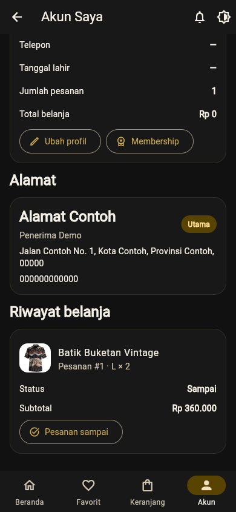

*Gambar 3.xx Tampilan Riwayat Pesanan pada Profil Customer*

Berdasarkan tampilan pada Gambar 3.xx, halaman Riwayat Pesanan terdiri atas beberapa komponen antarmuka yang digunakan untuk meninjau pembelian Customer. Komponen tersebut meliputi:

1. **Judul Riwayat belanja**, menandai awal daftar pembelian di bawah bagian Alamat pada Profil.
2. **Foto dan nama produk**, mengidentifikasi barang yang terdapat pada item pesanan.
3. **Nomor pesanan, ukuran, dan jumlah**, menghubungkan item dengan transaksi serta varian yang dibeli.
4. **Status dan subtotal**, menyajikan perkembangan pengiriman dan nilai item berdasarkan data backend.
5. **Tombol Pesanan sampai**, merupakan aksi konfirmasi penerimaan yang ditampilkan sesuai kemampuan item pada respons backend.

Saat Customer membuka `/profile`, aplikasi menerima `purchaseHistory` dari backend dan menampilkan kartu setiap item. Satu item berstatus “Sampai” terlihat pada pemeriksaan. Berdasarkan data item, aplikasi dapat menampilkan tindakan konfirmasi penerimaan, ulasan, dan retur. Pemeriksaan berhenti pada penayangan riwayat. Kartu riwayat tidak memiliki tautan langsung ke Ringkasan Pesanan pada implementasi saat ini.

### 3.3.12 Halaman Detail Pesanan

Detail Pesanan tersedia sebagai route **Ringkasan Pesanan** `/transaction/success/:id`. Halaman ini menampilkan keadaan pembayaran, status pengiriman, rincian nilai, alamat, dan produk milik pesanan Customer. Pemeriksaan awal berhasil membuka pesanan yang sudah ada pada akun seeder. Gambar berikut memakai pesanan demonstrasi yang dimuat dari database terisolasi.

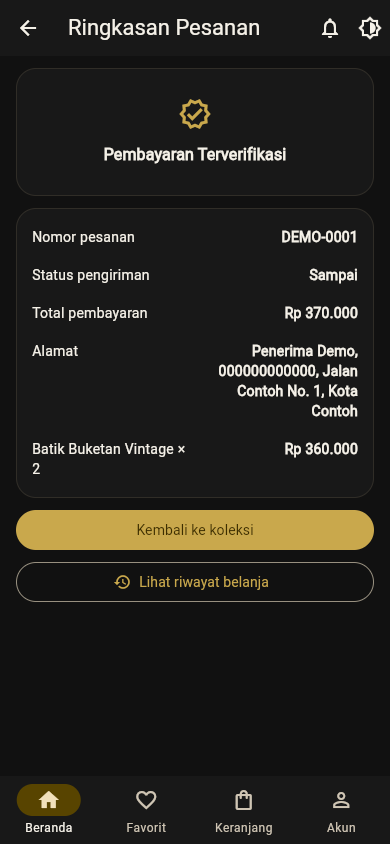

*Gambar 3.xx Tampilan Halaman Detail Pesanan*

Berdasarkan tampilan pada Gambar 3.xx, halaman Detail Pesanan terdiri atas beberapa komponen antarmuka yang digunakan untuk menyajikan rincian transaksi Customer. Komponen tersebut meliputi:

1. **Kartu status pembayaran**, memperlihatkan bahwa pembayaran pesanan yang dibuka telah terverifikasi.
2. **Nomor pesanan**, menampilkan identitas transaksi dari backend.
3. **Status pengiriman**, menunjukkan tahapan pengiriman yang pada tangkapan bernilai “Sampai”.
4. **Total pembayaran dan alamat**, menampilkan nilai akhir serta tujuan pengiriman yang tercatat pada pesanan.
5. **Daftar produk, jumlah, dan subtotal**, merinci barang serta nilai item dalam pesanan.
6. **Tombol Kembali ke koleksi dan Lihat riwayat belanja**, membuka katalog atau bagian riwayat pada Profil.

Saat membuka `/transaction/success/1`, aplikasi meminta data pesanan ke backend dan menampilkan status serta rincian yang dikembalikan. Tombol Kembali ke koleksi dan Lihat riwayat belanja memiliki tujuan route yang terverifikasi pada kode. Pemeriksaan mencakup penayangan ringkasan pesanan yang telah tersedia.

### 3.3.13 Halaman Informasi Pengiriman

Informasi Pengiriman ditampilkan sebagai bagian dari Ringkasan Pesanan dan Riwayat belanja bagi Customer. Kedua tampilan memperlihatkan status “Sampai” dalam skenario yang diperiksa. Status berada pada `OrderReceiptPage` dan `ProfilePage` sehingga subbab ini menggunakan rujukan gambar dari kedua bagian tersebut. [Ringkasan Pesanan](3.3-screenshot/12-detail-pesanan.png) · [Riwayat belanja](3.3-screenshot/11-riwayat-pesanan.png)

### 3.3.14 Halaman Profil Customer

Halaman Profil Customer menyajikan ringkasan akun, alamat, dan riwayat pembelian yang bersumber dari backend. Route `/profile` hanya tersedia setelah autentikasi Customer. Pada viewport pemeriksaan, bagian identitas dan alamat terlihat, sementara bagian Riwayat belanja berlanjut ke bawah halaman.

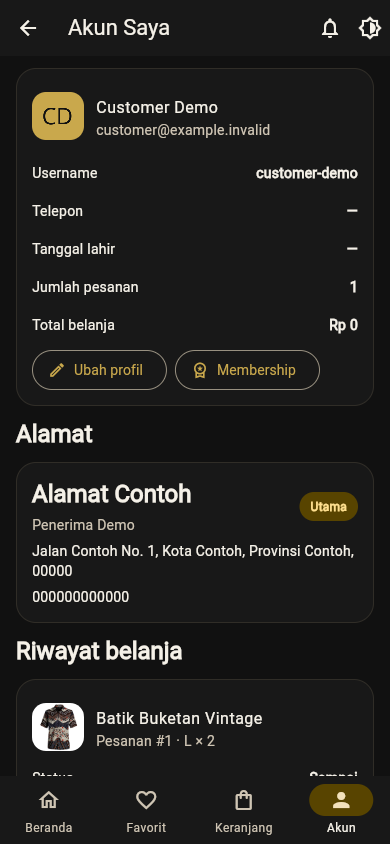

*Gambar 3.xx Tampilan Halaman Profil Customer*

Berdasarkan tampilan pada Gambar 3.xx, halaman Profil Customer terdiri atas beberapa komponen antarmuka yang digunakan untuk meninjau data akun dan aktivitas belanja. Komponen tersebut meliputi:

1. **Foto/inisial, nama, dan email**, mengidentifikasi akun Customer yang sedang masuk.
2. **Informasi username, telepon, dan tanggal lahir**, menampilkan data profil yang tersedia; nilai kosong disajikan sebagai tanda pisah.
3. **Jumlah pesanan dan total belanja**, menyajikan ringkasan aktivitas akun sesuai respons backend pada saat pemeriksaan.
4. **Tombol Ubah profil dan Membership**, membuka formulir profil atau informasi keanggotaan.
5. **Bagian Alamat**, menampilkan label, penerima, rincian tujuan, telepon, serta penanda alamat utama.
6. **Bagian Riwayat belanja**, memulai daftar item pesanan Customer di bawah kartu alamat.

Customer dapat membuka Profil melalui tab Akun. Aplikasi meminta `/profile` dan menampilkan data akun, alamat, serta riwayat dari backend. Tombol Ubah profil terhubung ke `/profile/edit`, yang juga berhasil dibuka saat pemeriksaan. Gambar memperlihatkan nilai profil dan alamat dari akun demonstrasi.

### 3.3.15 Halaman Edit Profil

Halaman Edit Profil memungkinkan Customer meninjau serta memperbarui informasi akun dan mengelola alamat. Route `/profile/edit` menampilkan nilai profil yang sudah tersimpan dalam formulir dan kartu alamat di bagian bawah. Pemeriksaan dibatasi pada pembukaan halaman serta panel Tambah alamat tanpa menyimpan perubahan.

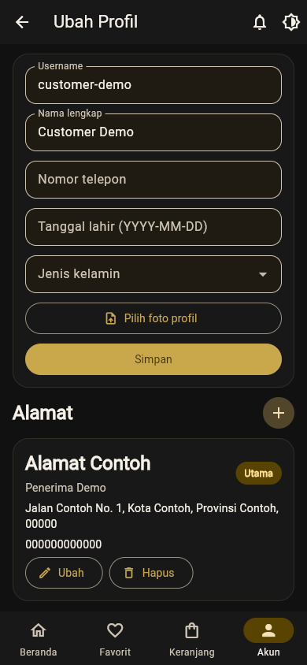

*Gambar 3.xx Tampilan Halaman Edit Profil*

Berdasarkan tampilan pada Gambar 3.xx, halaman Edit Profil terdiri atas beberapa komponen antarmuka yang digunakan untuk memperbarui data Customer. Komponen tersebut meliputi:

1. **Kolom Username dan Nama lengkap**, menampilkan nilai tersimpan yang dapat disunting.
2. **Kolom Nomor telepon dan Tanggal lahir**, menerima data kontak serta tanggal lahir; keduanya tampak kosong pada akun yang diuji.
3. **Pilihan Jenis kelamin dan tombol Pilih foto profil**, menyediakan pembaruan atribut profil serta gambar.
4. **Tombol Simpan**, mengirim perubahan profil melalui formulir.
5. **Bagian Alamat dan tombol tambah**, memperlihatkan alamat tersimpan serta membuka formulir alamat baru.
6. **Tombol Ubah dan Hapus pada kartu alamat**, menyediakan pengubahan dan penghapusan alamat; tindakan hapus menggunakan konfirmasi menurut kode.

Customer membuka Ubah profil dari Profil, kemudian aplikasi memuat nilai profil dan daftar alamat dari backend. Kode mengirim perubahan profil ke `/profile/edit` dan menyediakan operasi tambah, ubah, jadikan utama, serta hapus alamat pada bagian bawah. Dalam pengujian, tombol tambah berhasil membuka formulir yang terdokumentasi pada subbab 3.3.8; penyimpanan profil, pengubahan, dan penghapusan alamat tidak dijalankan.

## Batas verifikasi

Empat belas dari 15 topik utama mempunyai screenshot keadaan yang berhasil diakses; topik filter memiliki satu gambar tambahan untuk panelnya, sehingga terdapat **15 screenshot**. Alamat Pengiriman dan Riwayat Pesanan merupakan bagian halaman lain, sedangkan Informasi Pengiriman hanya berupa status pada Ringkasan Pesanan dan Riwayat belanja. Checkout dan Pembayaran terdokumentasi dalam keadaan prasyarat tidak terpenuhi. Pengujian dilakukan pada Flutter Web berukuran ponsel, bukan aplikasi Android/iOS native. Klaim fungsi untuk interaksi yang tidak dijalankan ditandai berdasarkan kode sumber, dan status per topik tersedia pada [hasil pemeriksaan](3.3-hasil-pemeriksaan.md).
